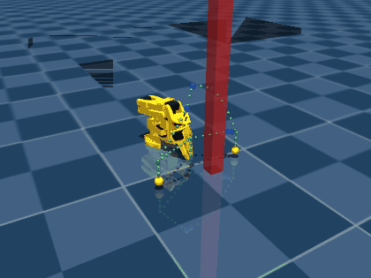
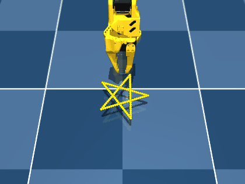
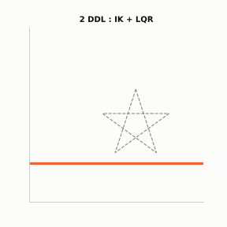

# TD Robotique — PID, LQR, A*, RRT, DMP sur pendule EDUKIT et bras LeRobot SO-101

**FERHANI - KULASINGAM - PREVOST - ATIG - BACHIRI - EL KHAMLICHI**  · **Année :** 2025-2026 ·
**Robots :** pendule inversé rotatif STEVAL-EDUKIT01, bras LeRobot SO-101 (6 DDL)

<p align="center">
  
  
  
</p>
<p align="center"><i>Pick & place avec évitement d'obstacle (A* + LQR) · parcours en étoile (LQR) · bras plan 2 DDL (pyro, IK + LQR)</i></p>

---

## En bref

Ce dépôt est notre compte rendu des TD de robotique : **tous les codes, les graphes, et une
analyse question par question**. Nous avons implémenté et comparé **PID, LQR, LQI, couple
calculé, A*, Dijkstra, RRT, RRT\* et DMP**, sur le pendule EDUKIT (en simulation) et sur le bras
SO-101 (en réel et en simulation), avec la bibliothèque **pyro** pour toutes les synthèses LQR.

Pour expliquer ce que nous avons observé sur le vrai bras, nous avons construit un **jumeau
numérique** : nos scripts originaux tournent sans modification, mais le bras est remplacé par
un bras MuJoCo physique (servos, gravité, temps de communication).

### Résultats principaux

| | Résultat | Chapitre |
|---|---|---|
| 1 | **`lerobot_IK` considère toute cible à moins de ~45 mm comme atteinte** (tolérance 1e-3 appliquée à une erreur *quadratique* dans `ik.cpp`) : c'est pourquoi `pid_ik_sim.py` finit à 28.3 mm de sa cible. Correctif d'une ligne → **0.46 mm** | [Q5](rapport/04_cinematique_PID_LQR.md#2-découverte--lerobot_ik--réussit--sans-bouger-pour-les-petits-déplacements) |
| 2 | Le graphe réel du pick & place (35.5 s, état LQR en retard sur sa consigne) s'explique par une **boucle à ~31 Hz au lieu de 50 Hz** : `lqr_step` intègre avec DT fixe. Correctif : dt mesuré (retard ÷ 9 à 40 ms) | [Q8](rapport/07_evitement_obstacles.md#1-ce-qui-est-réellement-fait-sur-le-bras) |
| 3 | Pendule : le LQR (pyro) divise par 2 l'écart du pendule après une poussée par rapport au double PID EDUKIT, tolère **60 ms** de retard (30 ms pour le PID) et garde **60° de marge de phase** (27°) | [Q3](rapport/02_pendule_LQR.md) |
| 4 | A* explore **10.7 fois moins** de cases que Dijkstra pour le même chemin ; RRT est 15 fois plus rapide qu'A* mais ses chemins sont 2 à 4 fois plus longs | [Q8](rapport/07_evitement_obstacles.md), [RRT](rapport/08_bonus_RRT.md) |
| 5 | Les pics de commande à ±15 rad/s² du graphe réel font **sortir l'état LQR du chemin planifié** (jusqu'à 10 cm en simulation) : une marge d'obstacle de 2.5 cm ne suffit pas sans loi horaire adaptée | [Améliorations](rapport/10_ameliorations.md) |

---

## Les questions du TD

| Question | Sujet | Statut | Code | Compte rendu |
|---|---|---|---|---|
| **Q1** | Faire tourner le PID (code de Shawn Hymel) | simulation | [`partie1_pendule/`](partie1_pendule) | [01 – Pendule : modèle et PID](rapport/01_pendule_PID.md) |
| **Q2** | Tester différentes valeurs de PID, graphes | simulation | [`q1_q2_pid.py`](partie1_pendule/q1_q2_pid.py) | [01](rapport/01_pendule_PID.md#3-q2--tester-différentes-valeurs-de-pid) |
| **Q3** | LQR (pyro), comparaison PID/LQR, matrices Q et R, vérification du modèle | simulation | [`q3_lqr.py`](partie1_pendule/q3_lqr.py) | [02 – Pendule : LQR](rapport/02_pendule_LQR.md) |
| **Q4** | Installer lerobot / lerobot-kinematics, piloter le bras | **réel** + sim | [`calibration_bras2.py`](partie2_so101/calibration_bras2.py) | [03 – Installation et calibration](rapport/03_lerobot_installation_calibration.md) |
| **Q5** | FK / IK pour PID et LQR ; bras 2D, multi-DDL, 3D ; modèle $\dot x = Ax + Bu$ | sim | [`pid_ik_sim.py`](partie2_so101/pid_ik_sim.py), [`pid_ik_real.py`](partie2_so101/pid_ik_real.py) | [04 – Cinématique, PID, LQR](rapport/04_cinematique_PID_LQR.md) |
| **Q6** | LQR de A vers B, parcours en étoile | sim + jumeau | [`lqr_etoile.py`](partie2_so101/lqr_etoile.py) | [05 – A → B et étoile](rapport/05_LQR_A_B_etoile.md) |
| **Q7** | Prendre un objet en A, le poser en B | **réel** + sim | [`pick_place_trajectoire_LQR.py`](partie2_so101/pick_place_trajectoire_LQR.py) | [06 – Pick & place](rapport/06_pick_and_place.md) |
| **Q8** | Interdire une zone (évitement d'obstacle) | **réel** + jumeau | [`pick_place_astar.py`](partie2_so101/pick_place_astar.py) | [07 – A* et analyse de l'essai réel](rapport/07_evitement_obstacles.md) |
| + | RRT et RRT* | sim | [`rrt_planner.py`](partie2_so101/rrt_planner.py) | [08 – RRT](rapport/08_bonus_RRT.md) |
| + | DMP (apprentissage d'un geste) | sim + jumeau | [`dmp.py`](partie2_so101/dmp.py) | [09 – DMP](rapport/09_bonus_DMP.md) |
| + | Robustesse PID/LQR (bruit, retard, erreur de modèle, saturation) | sim | [`robustesse_pendule.py`](partie1_pendule/robustesse_pendule.py) | [02 § 4](rapport/02_pendule_LQR.md#4-aller-plus-loin--robustesse-pid--lqr) |
| + | Défauts trouvés et correctifs vérifiés | sim + jumeau | [`ik_precise.py`](partie2_so101/ik_precise.py), [`s9`](simulations/s9_ameliorations.py) | [10 – Améliorations](rapport/10_ameliorations.md) |

À lire aussi : [00 – Méthodologie (réel / simulation / jumeau, reproduction)](rapport/00_methodologie.md) ·
[11 – Bilan](rapport/11_bilan.md) · **[Photos et vidéos des essais](media/README.md)**

---

## Organisation du dépôt

```
TD-Robotique-SO101/
├── README.md                     ← vous êtes ici
├── rapport/                      ← le compte rendu, un chapitre par question (00 à 11)
├── partie1_pendule/              ← pendule EDUKIT : modèle (pyro), PID, LQR, LQI, robustesse
├── partie2_so101/                ← NOS scripts pour le bras (à copier dans lerobot-kinematics/examples/)
│   ├── calibration_bras2.py          calibration des 6 servos (Q4)               [original]
│   ├── pid_ik_sim.py / pid_ik_real.py PID piloté par l'IK (Q5)                    [originaux]
│   ├── pick_place_trajectoire_LQR.py LQR + pick & place, trajectoires cartésiennes (Q6-Q7) [original]
│   ├── pick_place_astar.py           pick & place avec A* + LQR (Q8)             [original]
│   ├── astar_planner.py              planificateur A* 3D + collisions MuJoCo     [reconstruit]
│   ├── lqr_etoile.py                 A → B et parcours en étoile (Q6)           [nouveau]
│   ├── ik_precise.py                 correctif de lerobot_IK                     [nouveau]
│   ├── rrt_planner.py                RRT / RRT*                                  [nouveau]
│   └── dmp.py                        Dynamic Movement Primitives (+ mode teach) [nouveau]
├── simulations/                  ← études qui exécutent les scripts ci-dessus et produisent les figures (s1 à s9)
├── outils/                       ← jumeau numérique, banc d'essai, style des figures, shim lerobot-kinematics
├── figures/                      ← toutes les figures : partie1/, partie2/, bonus/, gif/, reel/ (essais réels)
└── media/                        ← photos et vidéos des essais (page dédiée)
```

## Lancer les scripts

**Sur le bras** (Windows, port `COM12`) :

```bash
git clone https://github.com/box2ai-robotics/lerobot-kinematics.git
cd lerobot-kinematics && pip install -e . && pip install lerobot mujoco matplotlib scipy
pip install git+https://github.com/SherbyRobotics/pyro
cp <ce dépôt>/partie2_so101/*.py examples/
python examples/calibration_bras2.py                  # une fois
python examples/pick_place_astar.py                   # MODE = "teach", puis "sim", puis "real"
```

**Toutes les figures, sans bras** : voir [méthodologie § 4](rapport/00_methodologie.md#4-reproduire-toutes-les-figures)
(`pip install -r requirements.txt`, puis les scripts `partie1_pendule/*.py` et `simulations/s*.py`).

## Références

* A. Girard *et al.*, **pyro** — https://github.com/SherbyRobotics/pyro
* Box2AI, **lerobot-kinematics** — https://github.com/box2ai-robotics/lerobot-kinematics
* S. Hymel, **pendulum-pid** — https://github.com/ShawnHymel/pendulum-pid
* W. Kaiser, **Edukit Rotary Inverted Pendulum Project** (firmware, gains du double PID) — https://github.com/wjkaiser/Edukit_Rotary_Inverted_Pendulum_Project
* Modèle EDUKIT (ωg², ωr², linéarisation) : guide EDUKIT (Tutorial 5) et l'audit https://github.com/Samarth030312/steval-edukit
* A. J. Ijspeert *et al.*, *Dynamical Movement Primitives*, Neural Computation, 2013 · H. Hoffmann *et al.*, ICRA 2009 (couplage d'évitement)
* S. Karaman, E. Frazzoli, *Sampling-based algorithms for optimal motion planning* (RRT*), IJRR 2011
