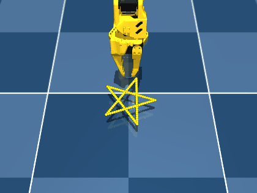
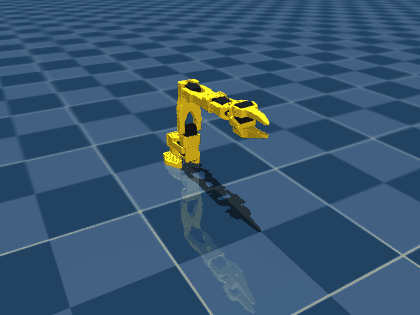
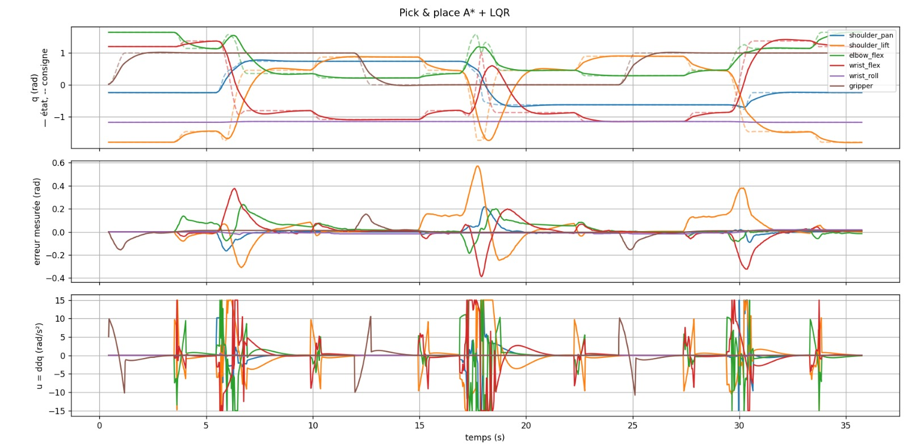
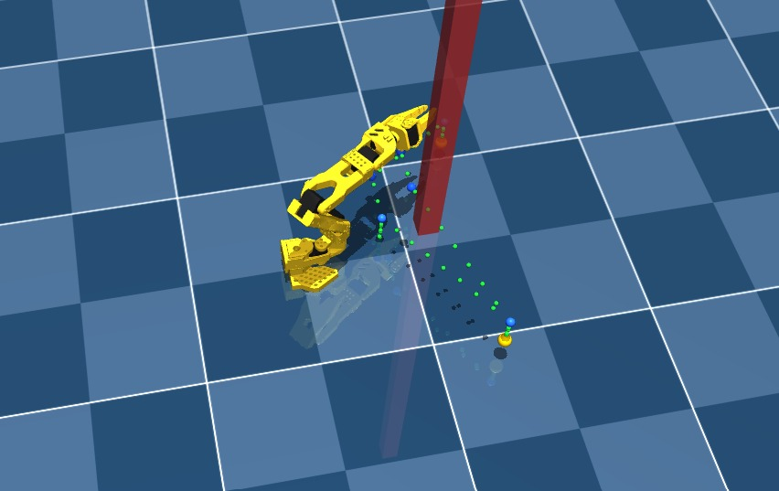

# Photos et vidéos des essais

> [← Sommaire](../README.md)
>
> Le sujet demande : *« Faites des photos et des vidéos de vos prouesses »*. Cette page les
> rassemble, question par question. Les cases « à ajouter » sont prêtes : il suffit de déposer
> les fichiers dans [`photos/`](photos) ou [`videos/`](videos) avec le nom indiqué.

## Comment ajouter un média

* **Photo** : déposer le fichier dans `media/photos/` (bouton *Add file → Upload files* sur
  GitHub), avec le nom prévu ci-dessous, puis remplacer `*(à ajouter)*` par
  ``.
* **Vidéo courte (< 10 Mo)** : la glisser directement dans l'éditeur de ce fichier sur GitHub
  (*Edit* → glisser-déposer le `.mp4`) : GitHub l'héberge et insère un lecteur. Pour une vidéo plus
  lourde : la mettre sur YouTube / Drive et coller le lien.
* **GIF** : idéal pour les mouvements courts (lu automatiquement dans le README).
* Pensez à filmer **en même temps** l'écran (MuJoCo + graphe) et le bras : c'est la meilleure
  preuve que la simulation et le réel correspondent.

---

## Partie 1 — pendule EDUKIT

| Essai | Fichier prévu | Média |
|---|---|---|
| Q1 : PID de Shawn Hymel, gains du notebook | `videos/q1_pid_shawn.mp4` | *(à ajouter)* |
| Q1 : valeur affichée de `Average interval` (capture d'écran) | `photos/q1_average_interval.png` | *(à ajouter)* |
| Q2 : 3 réglages de `K_P` (0.5 / 1 / 1.5) — graphes du notebook | `photos/q2_kp_*.png` | *(à ajouter)* |
| Q3 : LQR / double PID sur le banc, poussée à la main | `videos/q3_lqr_poussee.mp4` | *(à ajouter)* |

## Q4 — calibration et pilotage

| Essai | Fichier prévu | Média |
|---|---|---|
| Pose de référence (toutes articulations à 0) à côté de MuJoCo | `photos/q4_pose_reference.jpg` | *(à ajouter)* |
| Vérification « miroir » : MuJoCo suit le bras bougé à la main | `videos/q4_miroir_mujoco.mp4` | *(à ajouter)* |
| Montage : bras, carte du bus servo, alimentation | `photos/q4_montage.jpg` | *(à ajouter)* |

## Q5 — PID + IK

| Essai | Fichier prévu | Média |
|---|---|---|
| `pid_ik_real.py` avec l'IK d'origine puis avec `ik_precise` | `videos/q5_pid_ik_avant_apres.mp4` | *(à ajouter)* |

## Q6 — A → B et étoile

| Essai | Fichier prévu | Média |
|---|---|---|
| A → B en ligne droite (vue de côté) | `videos/q6_A_B.mp4` | *(à ajouter)* |
| Étoile dessinée au stylo, vue de dessus | `videos/q6_etoile.mp4`, `photos/q6_etoile_papier.jpg` | *(à ajouter)* |
| Simulation (déjà disponible) | |  |

## Q7 — pick & place

| Essai | Fichier prévu | Média |
|---|---|---|
| Pick & place réel (vue de côté) | `videos/q7_pick_place.mp4` | *(à ajouter)* |
| Pince fermée sur l'objet (gros plan) | `photos/q7_saisie.jpg` | *(à ajouter)* |
| Jumeau numérique (déjà disponible) | |  |

## Q8 — évitement d'obstacle

| Essai | Fichier prévu | Média |
|---|---|---|
| Graphe de l'essai réel | |  |
| Capture MuJoCo pendant l'essai réel | |  |
| Vidéo du bras qui contourne l'obstacle (avec un objet réel à l'endroit du poteau) | `videos/q8_astar_reel.mp4` | *(à ajouter)* |
| Écran MuJoCo + bras filmés ensemble | `videos/q8_ecran_et_bras.mp4` | *(à ajouter)* |

## Bonus

| Essai | Fichier prévu | Média |
|---|---|---|
| DMP : démonstration à la main (`MODE = "teach"`) puis rejeu | `videos/bonus_dmp.mp4` | *(à ajouter)* |
