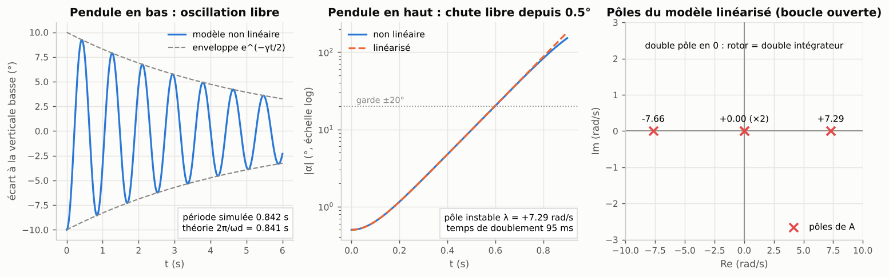
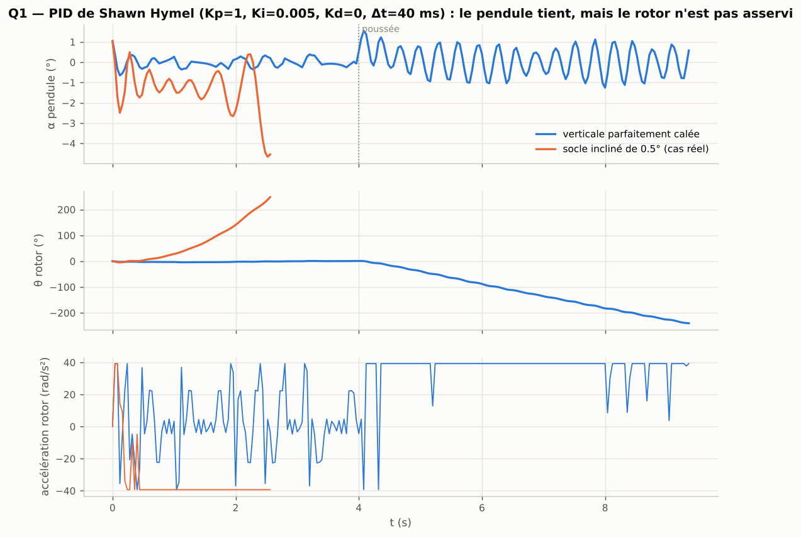
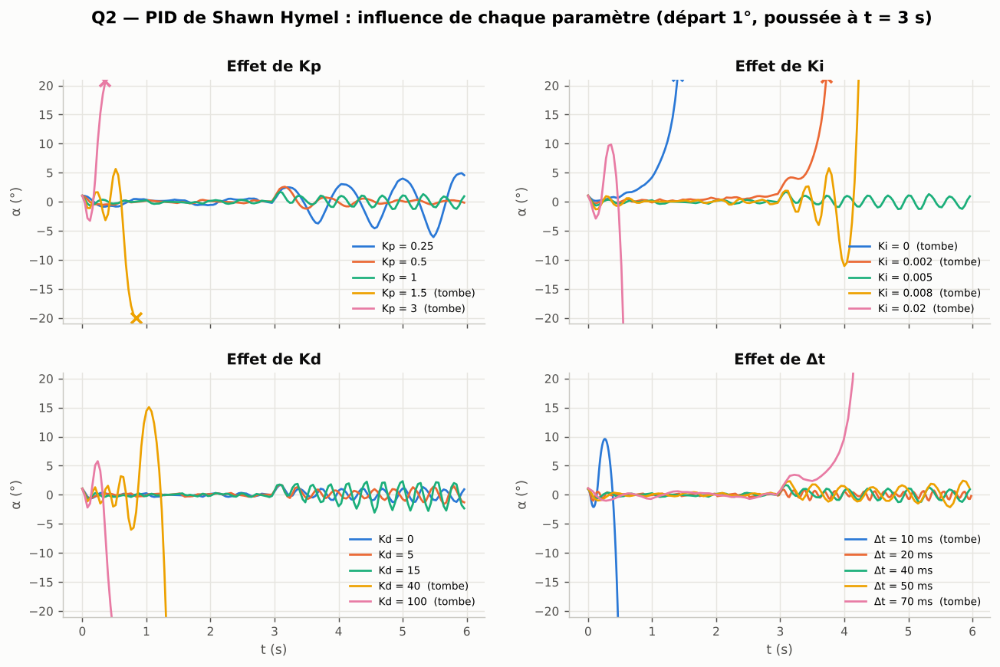
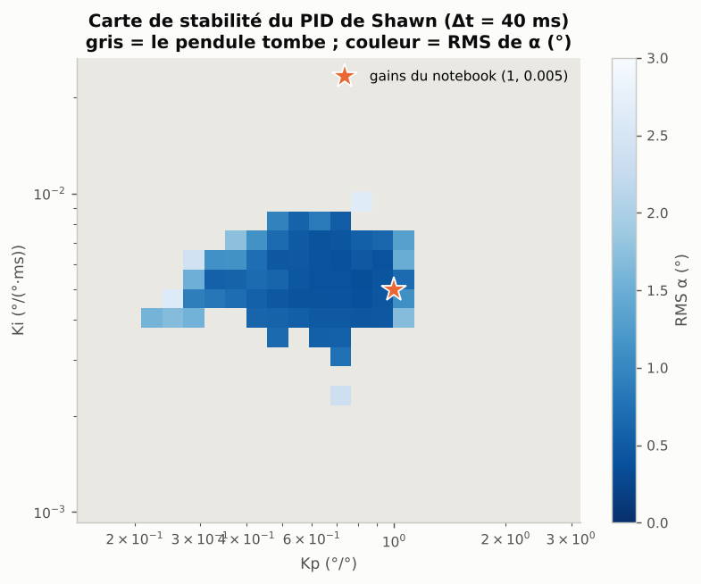
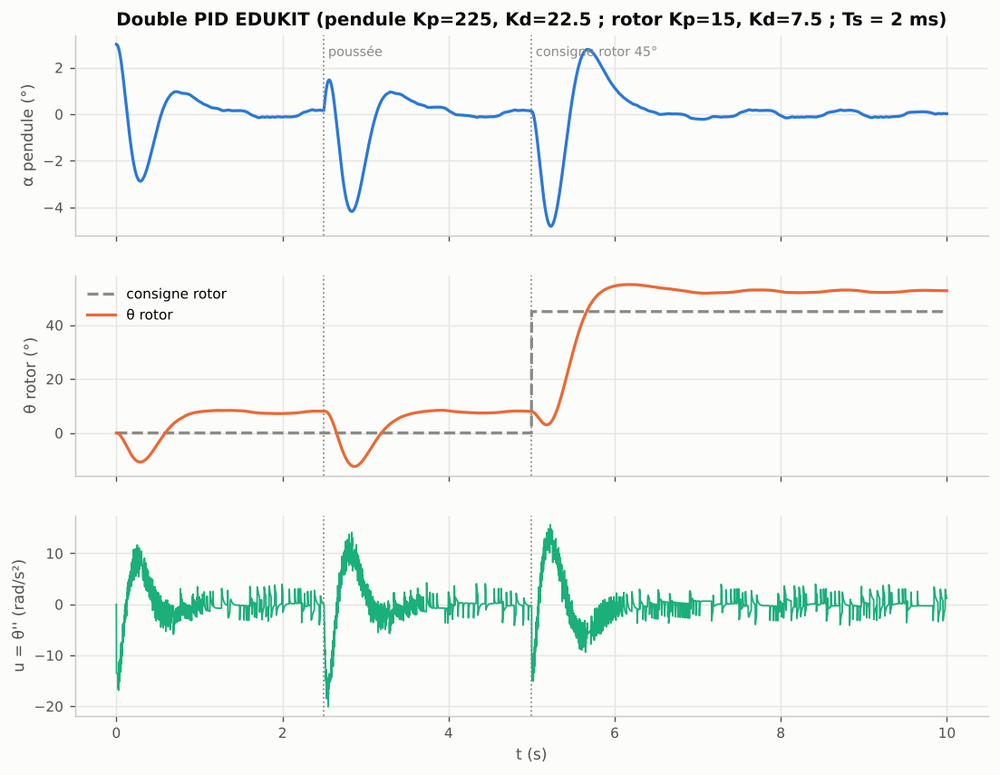
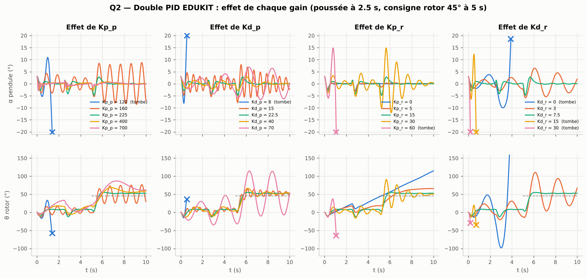
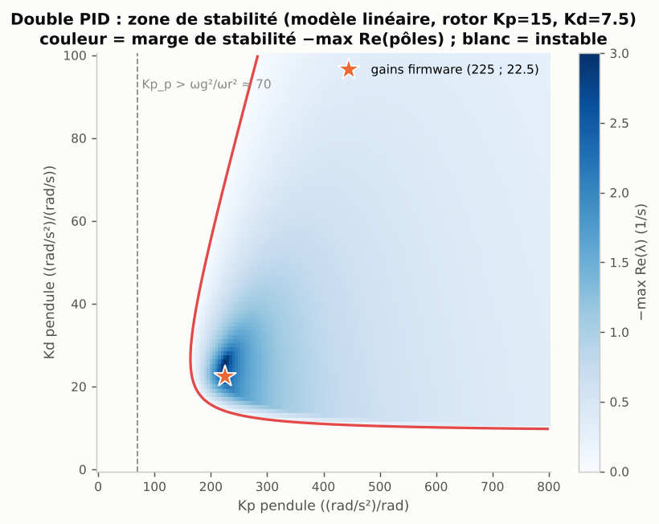

# Partie 1 — Pendule inversé EDUKIT : modèle et PID (Q1, Q2)

> [← Sommaire](../README.md) · [Q3 : LQR →](02_pendule_LQR.md)
>
> **Statut : simulation.** Nous n'avons pas de mesures sur le vrai pendule EDUKIT : tout ce
> chapitre repose sur un modèle physique (paramètres du guide EDUKIT) et sur une transcription
> fidèle des deux codes PID de référence. Les emplacements pour les essais réels sont dans
> [media/](../media/README.md#partie-1--pendule-edukit).

Code : [`partie1_pendule/`](../partie1_pendule) — `modele_pendule.py`, `commandes.py`,
`validation_modele.py`, `q1_q2_pid.py`.

---

## 1. Le modèle avant le correcteur

### 1.1 Équations

Le firmware EDUKIT commande le moteur pas-à-pas **en accélération** (fonction
`apply_acceleration` du `main.c` du projet EDUKIT) : on prend donc l'accélération du rotor
comme entrée, $u = \ddot\theta$. Avec $\alpha$ l'angle du pendule mesuré depuis la verticale
haute, Lagrange donne (tige + masse en bout, bras de rotor $r$) :

$$
\ddot\alpha = \omega_g^2 \sin\alpha + \omega_r^2 \cos\alpha \; u + \dot\theta^2 \sin\alpha\cos\alpha - \gamma\,\dot\alpha
\qquad
\omega_g^2 = \frac{m g l_c}{J},\quad \omega_r^2 = \frac{m r l_c}{J},\quad \gamma = \frac{c}{J}
$$

Linéarisé autour de $\alpha = 0$, avec $x = [\theta,\ \alpha,\ \dot\theta,\ \dot\alpha]^T$ :

$$
\dot x = \underbrace{\begin{bmatrix}0&0&1&0\\0&0&0&1\\0&0&0&0\\0&\omega_g^2&0&-\gamma\end{bmatrix}}_{A} x
+ \underbrace{\begin{bmatrix}0\\0\\1\\ \omega_r^2\end{bmatrix}}_{B} u
$$

C'est exactement la structure « $y = Ax + Bu$ » demandée par le TD. Valeurs utilisées
(Tutorial 5 du guide EDUKIT, pendule en haut) : $\omega_g^2 = 55.85\ \text{rad}^2/\text{s}^2$,
$\omega_r^2 = 0.803$ (ce qui donne bien $r = \omega_r^2 g/\omega_g^2 \approx 0.14$ m, la longueur
du bras), facteur de qualité $Q \approx 20$ donc $\gamma = \omega_g/Q = 0.37\ \text{s}^{-1}$.

Le modèle existe en deux versions dans `modele_pendule.py` : des fonctions NumPy (`f_nonlineaire`,
`rk4`) et une classe **pyro** `PenduleRotatifEdukit(ContinuousDynamicSystem)`, ce qui permet
d'utiliser les outils de pyro (linéarisation numérique, `ctl + sys`, simulation).

### 1.2 Vérification en simulation (Q3 : « vérifiez en simulation la dynamique du système »)



| Vérification | Résultat | Commentaire |
|---|---|---|
| Période d'oscillation, pendule en bas (simulation non linéaire, 10°) | **0.842 s** | théorie $2\pi/\sqrt{\omega_g^2-\gamma^2/4}$ = 0.841 s : le modèle a la bonne « horloge » |
| Pôle instable, pendule en haut | **+7.29 rad/s** | l'angle double toutes les **95 ms** |
| Chute libre de 0.5° à 20° | **0.60 s** | c'est le temps dont dispose le correcteur s'il « rate » quelques cycles |
| Linéarisation numérique pyro (`linearize`) contre $A$, $B$ analytiques | écart max **9·10⁻⁸** | la classe pyro et nos équations sont identiques |
| Pôles de $A$ | −7.66, **+7.29**, 0, 0 | double pôle en 0 : le rotor est un double intégrateur |

**Ce qu'il faut retenir.** Le système est instable avec une constante de temps d'environ 0.1 s :
toute boucle de commande doit avoir une bande passante nettement plus rapide que 7 rad/s
**et** un retard bien inférieur à 100 ms. Le double pôle en 0 dit autre chose : même si le
pendule est stabilisé, **le rotor dérive** tant qu'on ne mesure pas sa position.

---

## 2. Q1 — Faire tourner le PID de Shawn Hymel

### 2.1 Ce que fait réellement le code

Le notebook [`pendulum-pid.ipynb`](https://github.com/ShawnHymel/pendulum-pid) exécute en Python,
à chaque échange série avec l'Arduino :

```python
error    = SETPOINT - enc_deg                    # degrés, SETPOINT = 180 (pendule en haut)
integral = integral + (error * interval)         # interval en MILLISECONDES
derivative = (error - error_prev) / interval
move_deg = (K_P * error) + (K_I * integral) + (K_D * derivative) + BIAS
ctrl.step(CMD_MOVE_BY, [move_deg])               # le moteur AVANCE de move_deg degrés
```

avec `K_P = 1`, `K_I = 0.005`, `K_D = 0`, codeur à 1200 pas/tour (0.3°) et moteur en 1/8 de pas
(`STEP_MODE_8`, 1600 micro-pas/tour, accélération 10 000 pas/s², vitesse 5 000 pas/s dans le
sketch). Nous l'avons transcrit ligne pour ligne dans `commandes.PIDShawn`, y compris
la troncature `(int)` des micro-pas du sketch Arduino.

**Analyse concrète — la sortie n'est pas une accélération, c'est un *déplacement* par
échantillon.** Si la boucle tourne à la période $\Delta t$, la vitesse du rotor vaut
$\dot\theta \approx \text{move}/\Delta t$, donc son accélération :

$$
\ddot\theta \approx \frac{K_P\,\dot e + 1000\,K_I\,e}{\Delta t}
$$

Vis-à-vis de la physique (le pendule réagit à $\ddot\theta$), **`K_P` joue le rôle d'un gain
dérivé et `K_I` celui d'un gain proportionnel**, et les deux sont divisés par $\Delta t$.
Conséquences directes, toutes vérifiées en simulation :

* les gains « efficaces » dépendent de la **période de la boucle USB-série**, qui n'est pas
  maîtrisée (le notebook affiche d'ailleurs `Average interval` à la fin : **c'est la première
  mesure à faire sur le vrai banc**) ;
* sans `K_I` il n'y a aucun terme « ressort » : le pendule tombe (Q2, `Ki = 0`) ;
* la position du rotor n'est jamais mesurée : rien ne l'empêche de tourner indéfiniment.

### 2.2 Résultat



Avec une boucle de 40 ms, un départ à 1° et une poussée à 4 s :

* verticale bien calée (bleu) : le pendule tient (|α| < 1.6°) mais **le rotor dérive jusqu'à
  la butée de 240°** environ 5 s après la poussée ;
* socle incliné de 0.5° (orange, ordre de grandeur mesuré sur un vrai kit EDUKIT) : l'erreur
  ne s'annule jamais, l'intégrale grossit, **le rotor part en 2.5 s**.

C'est le comportement attendu d'un correcteur qui ne régule qu'**une** des deux sorties
d'un système à **une** entrée et **deux** degrés de liberté.

---

## 3. Q2 — Tester différentes valeurs de PID

### 3.1 PID de Shawn Hymel : chaque gain, puis la carte de stabilité



| Gain | Observation (simulation) | Explication |
|---|---|---|
| `K_P` 0.25 → 3 | 0.25 : tient mais oscille (±6° après la poussée) ; **0.5–1 : stable** ; ≥ 1.5 : tombe | `K_P` = amortissement ; trop fort, la commande sature l'accélération du moteur (39 rad/s²) et le retard d'un échantillon devient déstabilisant |
| `K_I` 0 → 0.02 | 0 : tombe ; 0.002 : trop mou, tombe à la poussée ; **0.005 : stable** ; ≥ 0.008 : tombe | `K_I` = raideur : il faut $\omega_r^2 \cdot 5/\Delta t > \omega_g^2$ |
| `K_D` 0 → 100 | ≤ 5 : quasi identique ; 15 : oscillations entretenues ±2° ; ≥ 40 : tombe | `K_D` agit sur $\ddot e$ : il amplifie le bruit de quantification (0.3°) |
| période Δt 10 → 70 ms | **10 ms : tombe** ; 20–50 ms : stable ; 70 ms : tombe | gains efficaces ∝ 1/Δt : la même valeur de `K_P` est 4 fois plus agressive à 10 ms qu'à 40 ms |



La carte (22 × 22 simulations non linéaires complètes) montre que la zone stable est **une
petite île** et que les gains du notebook (étoile) sont **sur son bord**. Cela explique
pourquoi ce PID demande un réglage « à la main » sur chaque banc : un changement de période
de boucle, de micro-pas ou de pendule fait sortir de l'île.

### 3.2 Double PID du firmware EDUKIT : la bonne architecture

Le firmware EDUKIT (`ENABLE_DUAL_PID = 1`) additionne un PID sur le pendule et un PID sur le
rotor, sorties en accélération, à **2 ms**, avec des dérivées filtrées (10 Hz et 50 Hz).
Gains `MODE_1` du fichier `edukit_system.h` convertis en unités SI (1 pas codeur = 2π/2400,
1 pas moteur = 2π/3200, d'où un facteur 0.75) : pendule $K_p = 225$, $K_d = 22.5$ ;
rotor $K_p = 15$, $K_d = 7.5$.



Trois observations concrètes :

1. **Le rotor revient et suit une consigne** (45° à t = 5 s) : la dérive de Q1 a disparu.
2. **Erreur statique de 7.7°** avec le socle incliné de 0.5°. Elle se calcule à la main : à
   l'équilibre $u = 0$, donc $K_{p,pend}\cdot 0.5° = K_{p,rot}\cdot \varepsilon_\theta$, soit
   $\varepsilon_\theta = 225 \times 0.5 / 15 = 7.5°$. Il faut un **intégrateur sur le rotor**
   (voir LQI au chapitre suivant).
3. **Réponse inverse** : quand la consigne rotor passe à 45°, le rotor part d'abord **dans le
   mauvais sens** (de 8° à 3°) pour incliner le pendule vers l'avant : c'est la signature d'un
   système **à non-minimum de phase**. C'est aussi pourquoi le PID rotor a un signe
   « positif » ($u = +K_{p,r}\,\theta$) : un PID rotor « intuitif » fait tomber le pendule.



| Gain | Effet observé |
|---|---|
| `Kp_p` (pendule) | < 70 : instable (il faut $K_{p} > \omega_g^2/\omega_r^2 \approx 70$) ; 120 : tombe en pratique ; 160 : oscillations entretenues ; 225–700 : de plus en plus raide |
| `Kd_p` | 8 : tombe ; 15 : oscillations ; 22.5–40 : bien amorti ; 70 : lent et oscillant sur le rotor |
| `Kp_r` (rotor) | 0 : le rotor dérive (rampe) ; 5 : lent ; 15 : bon ; 30 : oscillant ; 60 : instable |
| `Kd_r` | 0 : instable ; 3 : oscillations lentes ; 7.5 : bon ; ≥ 15 : instable |



La zone de stabilité linéaire (valeurs propres de $A - BK$) confirme la borne
$K_{p} > \omega_g^2/\omega_r^2$ et montre que les gains du firmware sont au milieu d'une large
zone, contrairement au PID mono-boucle.

Tous les chiffres : [`figures/partie1/p1_q1_q2_metriques.md`](../figures/partie1/p1_q1_q2_metriques.md).

---

## 4. Réflexion

* **Un PID mono-boucle n'est pas « faux », il est incomplet** : il stabilise un état sur deux.
  Le double PID est en réalité un **retour d'état** $u = -Kx$ avec $K = [-15,\ 225,\ -7.5,\ 22.5]$ :
  c'est déjà la structure d'un LQR, avec des gains choisis à la main.
* **La période d'échantillonnage fait partie du réglage.** Le même jeu de gains passe de stable
  à instable entre 10 et 20 ms (Shawn). Sur le vrai banc, mesurer `Average interval` avant de
  toucher à un gain.
* **Les défauts mécaniques comptent autant que les gains** : une inclinaison de 0.5° suffit à
  envoyer le rotor en butée (Shawn) ou à créer 7.5° d'erreur statique (double PID).

### Protocole proposé pour l'essai réel (à compléter avec vos mesures)

1. Lancer le notebook tel quel, noter `Average interval` et la durée avant `Episode terminated`.
2. Reprendre trois points du balayage `K_P ∈ {0.5, 1, 1.5}` et comparer aux courbes ci-dessus.
3. Mesurer la dérive du rotor (°/s) : comparer à la simulation.
4. Déposer les graphes et vidéos dans [`media/`](../media/README.md).
