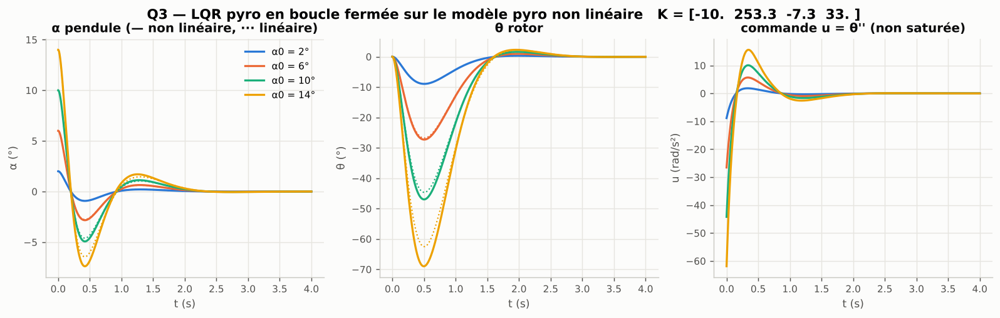
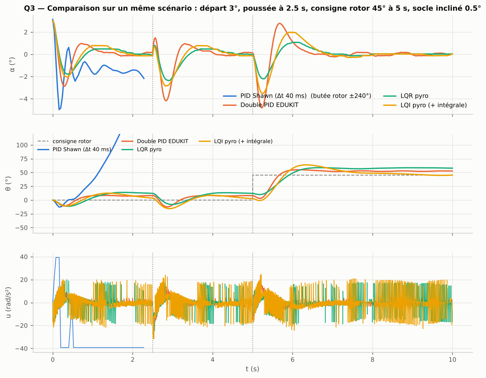
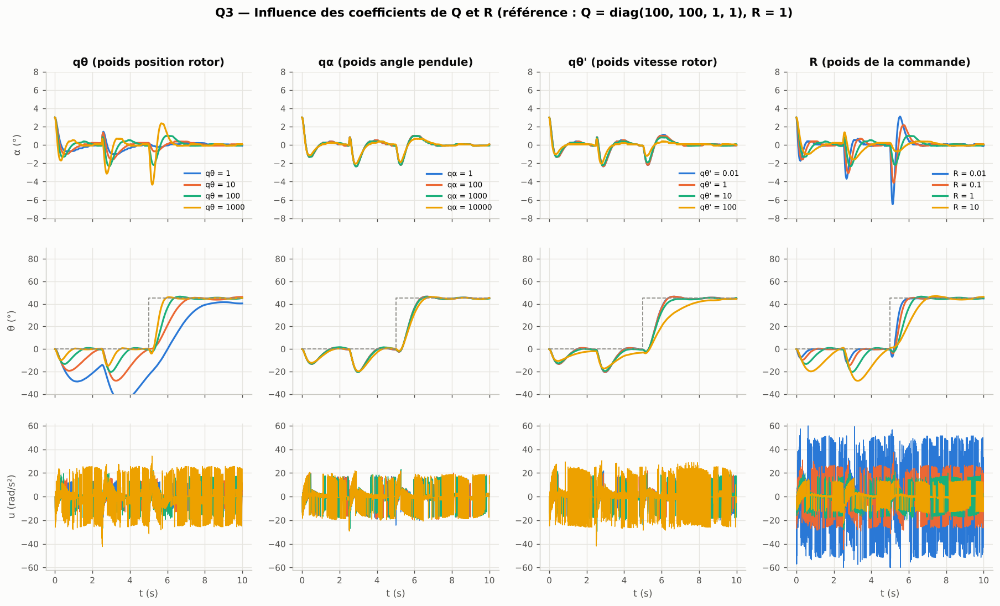
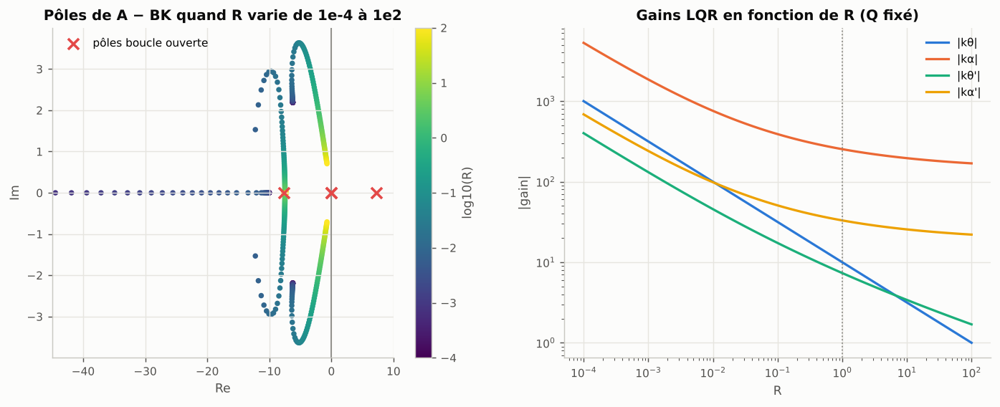
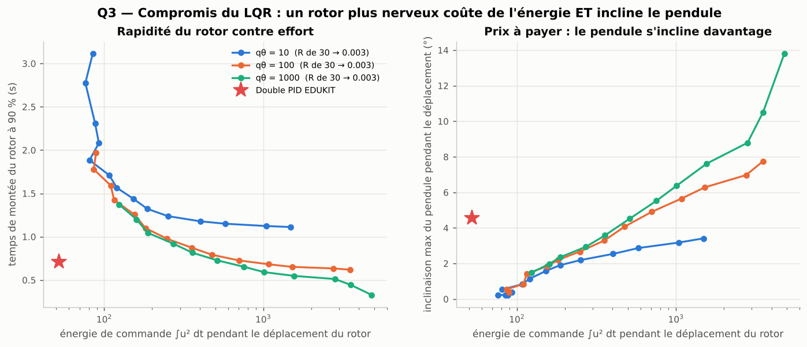
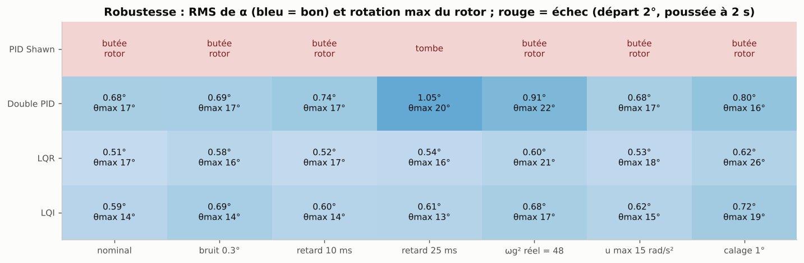
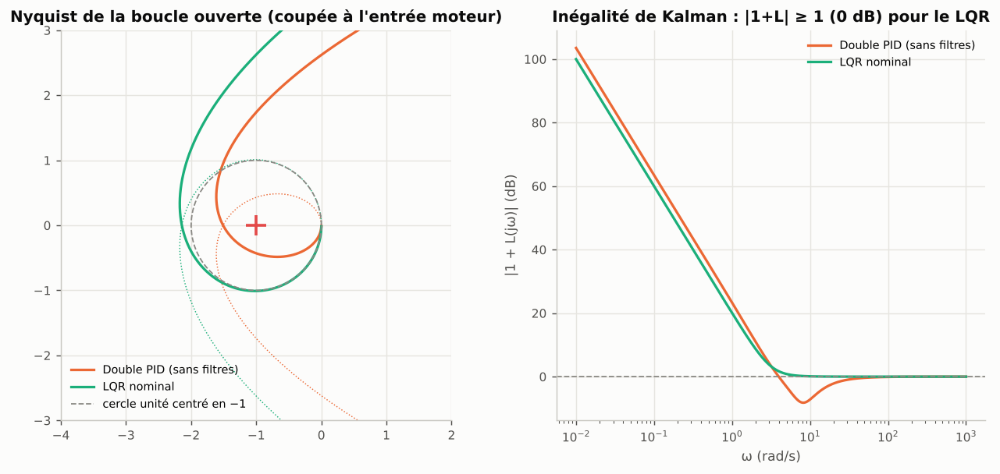

# Partie 1 — Pendule EDUKIT : LQR avec pyro et comparaison au PID (Q3)

> [← Q1-Q2 : PID](01_pendule_PID.md) · [Sommaire](../README.md) · [Q4 : LeRobot →](03_lerobot_installation_calibration.md)
>
> **Statut : simulation** (même modèle et même simulateur que le chapitre précédent).

Code : [`partie1_pendule/q3_lqr.py`](../partie1_pendule/q3_lqr.py),
[`commandes.py`](../partie1_pendule/commandes.py) (classes `LQR`, `LQI`, fonctions `gain_lqr`,
`gain_lqi`), [`robustesse_pendule.py`](../partie1_pendule/robustesse_pendule.py).

---

## 1. Algorithme

Le LQR cherche la commande $u = -Kx$ qui minimise

```math
J = \int_0^\infty \left( x^T Q x + u^T R u \right) dt
```

pour le modèle linéarisé $\dot x = Ax + Bu$ du [chapitre 1](01_pendule_PID.md#11-équations).
La solution passe par l'équation de Riccati algébrique :

```
1.  Résoudre  AᵀS + SA − S B R⁻¹ Bᵀ S + Q = 0      (S symétrique définie positive)
2.  K = R⁻¹ Bᵀ S
3.  À chaque période Ts = 2 ms :
        x̂ = [θ_mes − θ_ref, α_mes, dθ̂, dα̂]        (vitesses : dérivées filtrées 50 Hz)
        u = −K x̂ ,  saturé à ±60 rad/s²
```

Dans le code, l'étape 1–2 est faite **par pyro**, comme dans l'exemple de la bibliothèque :

```python
ss = StateSpaceSystem(A, B, np.eye(4), np.zeros((4, 1)))
cf = QuadraticCostFunction(4, 1); cf.Q, cf.R = Q, R
K  = synthesize_lqr_controller(ss, cf).K           # solve_continuous_are + R⁻¹BᵀS
```

et une première simulation est faite **entièrement dans pyro** : contrôleur pyro + modèle
non linéaire pyro (`ctl + PenduleRotatifEdukit()`, `compute_trajectory`).

Réglage nominal : $Q = \mathrm{diag}(q_\theta, q_\alpha, q_{\dot\theta}, q_{\dot\alpha}) = \mathrm{diag}(100, 100, 1, 1)$, $R = 1$ :

```math
K = [-10.0,\ 253.3,\ -7.34,\ 33.05] \qquad \text{pôles : } -7.50 \pm 0.30j,\ -2.28 \pm 2.17j
```

Les signes de $K$ sont **les mêmes que ceux du double PID EDUKIT** $[-15, 225, -7.5, 22.5]$ :
le firmware est un retour d'état réglé à la main, le LQR le règle par optimisation.



*Simulation 100 % pyro, sans saturation : jusqu'à 6° le non linéaire (traits pleins) et le
linéaire (pointillés) sont confondus ; à 14° le non linéaire s'écarte (sin α < α, cos α < 1) et
la commande initiale dépasse 60 rad/s², ce qui dépasserait le moteur réel.*

---

## 2. Comparaison PID / LQR sur un même scénario

Même simulateur réaliste pour tous (modèle non linéaire, codeur 0.15°, Ts = 2 ms, saturation
60 rad/s², socle incliné de 0.5°) : départ à 3°, poussée à 2.5 s, consigne rotor 45° à 5 s.



| Contrôleur | Tombe ? | max\|α\| après poussée | RMS α | θ final (consigne 45°) | erreur statique θ | max\|u\| | ∫u² dt |
|---|---|---|---|---|---|---|---|
| PID Shawn (Δt 40 ms) | **oui : butée rotor 240°** | – | – | 240° | – | – | – |
| Double PID EDUKIT | non | 4.82° | 1.24° | 52.7° | +7.7° | 20.1 | 99 |
| **LQR pyro** | non | **2.36°** | **0.74°** | 57.9° | +12.9° | 26.7 | 260 |
| **LQI pyro** (+ intégrale) | non | 3.52° | 1.06° | **45.3°** | **+0.3°** | 31.9 | 344 |

**Lecture concrète.**

* Le LQR **divise par 2 l'écart du pendule** après la poussée (2.36° contre 4.82°) par rapport
  au double PID, pour 2.6 fois plus d'énergie de commande : il « dépense » mieux sa commande.
* Ni le double PID ni le LQR n'annulent l'erreur rotor due au socle incliné : sans intégrateur,
  l'équilibre impose $k_\alpha\,\delta = k_\theta\,\varepsilon_\theta$ (12.9° pour le LQR car son
  rapport $k_\alpha/k_\theta = 25$ est plus grand que celui du PID, 15).
* **Aller plus loin — LQI** : on ajoute l'état $z = \int(\theta - \theta_{ref})\,dt$ et on refait
  le Riccati sur le système 5×5 (`gain_lqi`). L'erreur statique tombe à **0.3°** (= quantification
  du codeur moteur près).

---

## 3. Influence des coefficients de Q et R



| Variation | K = [kθ, kα, kθ', kα'] | pôle le plus lent | RMS α | max\|u\| | ∫u² |
|---|---|---|---|---|---|
| qθ = 1 | [-1.0, 175.4, -2.0, 22.9] | 0.86 | 0.38° | 19.6 | 115 |
| qθ = 100 (réf.) | [-10.0, 253.3, -7.3, 33.0] | 2.28 | 0.73° | 28.2 | 260 |
| qθ = 1000 | [-31.6, 375.3, -16.7, 49.0] | 4.01 | 1.06° | 42.4 | 723 |
| qα = 1 | [-10.0, 252.8, -7.3, 33.0] | 2.29 | 0.73° | 28.3 | 260 |
| qα = 10 000 | [-10.0, 292.3, -8.1, 35.9] | 1.77 | 0.63° | 29.3 | 285 |
| qθ' = 100 | [-10.0, 374.6, -13.7, 48.9] | 1.01 | 0.47° | 42.0 | 595 |
| R = 0.01 | [-100.0, 757.4, -45.6, 98.5] | 6.34 | 1.24° | **60 (saturé)** | 2735 |
| R = 10 | [-3.2, 195.8, -3.4, 25.6] | 1.27 | 0.50° | 22.5 | 151 |

Ce que montrent les courbes et le tableau :

1. **$q_\theta$ règle la rapidité du rotor** : ×10 sur $q_\theta$ ⇒ $k_\theta$ ×√10 (−1 → −3.2 → −10 → −31.6).
   Avec $q_\theta = 1$ le rotor met 5 s à rejoindre 45° et s'écarte de 40° lors de la poussée ;
   avec 1000 il y va en 1 s mais le pendule s'incline de 4.3°.
2. **$q_\alpha$ n'a presque aucun effet entre 1 et 1000** — résultat contre-intuitif. Le gain $k_\alpha$
   est d'abord *imposé par la stabilisation* (il faut $k_\alpha\,\omega_r^2 > \omega_g^2$, soit
   $k_\alpha > 70$) : pour bouger le rotor, le LQR doit de toute façon incliner le pendule, et le
   coût de cette inclinaison est négligeable devant celui de l'erreur de rotor. Il faut
   $q_\alpha \gtrsim 10^4$ pour que le terme pendule pèse.
3. **$q_{\dot\theta}$ amortit le rotor** : avec 100, le rotor ne dépasse plus mais devient lent
   (pôle à −1.0).
4. **$R$ est le bouton global « agressivité »** : quand $R$ diminue, tous les gains augmentent
   ($k \propto R^{-1/2}$ pour les termes dominants). À $R = 0.01$ la commande sature en permanence à
   60 rad/s² et la quantification du codeur est amplifiée : le pendule est *moins* droit
   (RMS 1.24°) qu'avec $R = 1$.



*Quand $R \to \infty$ (commande « chère »), le pôle instable +7.29 est ramené en son symétrique
−7.29 et les pôles du rotor tendent vers 0 : le LQR fait le minimum pour stabiliser. Quand
$R \to 0$, les pôles partent vers l'infini (asymptotes de Butterworth) : bande passante
illimitée… en théorie.*



*Front de Pareto obtenu en simulation non linéaire (chaque point = un R). Pour $q_\theta = 100$,
passer d'une montée du rotor en 1.4 s à 0.7 s multiplie l'énergie de commande par environ 8
(∫u² de ~120 à ~1000) **et** l'inclinaison du pendule pendant le déplacement par environ 4.
Le double PID EDUKIT (étoile) est à la fois rapide (0.7 s) et économe (∫u² ≈ 50)… mais il
incline le pendule de 4.6°, là où un LQR de même énergie reste sous 1° : il a choisi un autre
compromis, où la position du pendule compte peu. Aucun réglage n'est « meilleur partout » ;
le LQR rend ce choix explicite via Q et R.*

---

## 4. Aller plus loin — robustesse PID / LQR

Code : [`robustesse_pendule.py`](../partie1_pendule/robustesse_pendule.py). Départ 2°, poussée à 2 s.



| Contrôleur | nominal | bruit 0.3° | retard 10 ms | retard 25 ms | ωg² réel = 48 | u max 15 rad/s² | calage 1° |
|---|---|---|---|---|---|---|---|
| PID Shawn | butée rotor | butée rotor | butée rotor | tombe | butée rotor | butée rotor | butée rotor |
| Double PID | 0.68° | 0.69° | 0.74° | 1.05° | 0.91° | 0.68° | 0.80° |
| LQR | **0.51°** | **0.58°** | **0.52°** | **0.54°** | **0.60°** | **0.53°** | 0.62° (θ 26°) |
| LQI | 0.59° | 0.69° | 0.60° | 0.61° | 0.68° | 0.62° | 0.72° (θ 19°) |

*(RMS de α ; la colonne « ωg² réel = 48 » utilise la valeur mesurée par oscillations libres sur
un vrai kit, au lieu de 55.85 : 14 % d'erreur de modèle.)*

| Indicateur | Double PID | LQR | LQI | PID Shawn |
|---|---|---|---|---|
| Retard pur toléré (simulation) | 30 ms | **60 ms** | 50 ms | – |
| Plus grand angle initial rattrapé | 19.2° | **24.1°** | 22.6° | 5.9° |
| Marge de phase (Nyquist, continu) | 27° | **60°** | – | – |



**Pourquoi le LQR est plus robuste — un résultat de cours vérifié numériquement.** Pour un LQR
à retour d'état complet, l'inégalité de Kalman garantit $|1 + L(j\omega)| \ge 1$ à toutes les
fréquences, donc une marge de phase d'au moins 60° et une marge de gain de [½, ∞[. La figure de
droite le montre : la courbe LQR ne descend jamais sous 0 dB, alors que celle du double PID
descend à −8 dB vers 8 rad/s (marge de phase 27°). La simulation non linéaire confirme : le LQR
supporte 60 ms de retard, le double PID 30 ms.

**Bassin d'attraction et saturation** : avec $R = 0.01$, le LQR ne rattrape plus que 16° (contre
24° pour $R = 1$) : des gains trop grands saturent le moteur dès le départ et la commande saturée
n'est plus optimale. Un bon réglage n'est donc pas « le plus agressif possible ».

---

## 5. Réflexion

* Le **LQR n'invente pas une nouvelle structure** : sur ce système c'est un double PD. Son
  apport est **méthodologique** : on règle 4 gains couplés avec 2–3 poids qui ont un sens
  physique (« combien je tolère d'erreur rotor par rapport à l'effort »), et on hérite de marges
  de robustesse garanties.
* **Ce que le LQR ne fait pas** : il ne compense ni les biais (socle incliné → LQI), ni les
  saturations (→ choisir $R$ raisonnable, ou commande prédictive), ni l'erreur de modèle sur
  $\omega_r^2$ (→ identification sur le banc).
* La règle de **Bryson** ($Q_{ii} = 1/x_{i,max}^2$, $R = 1/u_{max}^2$) est un bon point de
  départ : avec $\theta_{max} = 30°$, $\alpha_{max} = 2°$, $u_{max} = 20$ rad/s², elle donne
  K = [−38.5, 860.8, −29.9, 85.9], 3 à 4 fois plus agressif que notre réglage nominal, qui sature
  à 60 rad/s² en simulation — preuve qu'il faut
  ensuite **vérifier en simulation non linéaire** avec le bruit et les saturations, comme fait ici.
