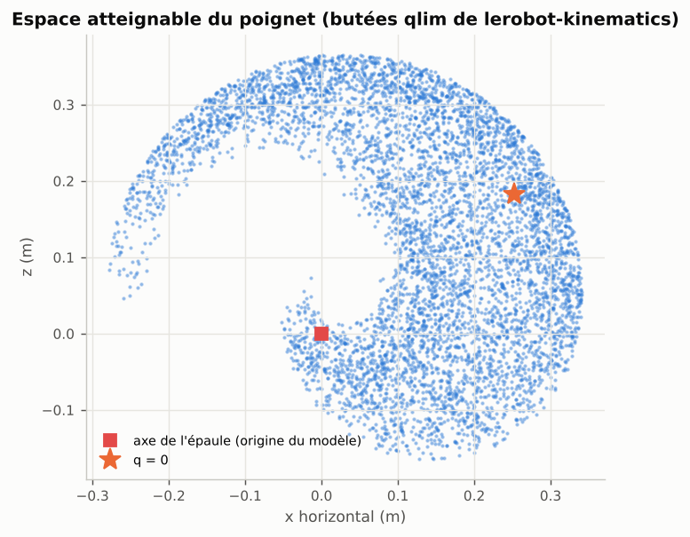

# Partie 2 — Q4 : installer lerobot / lerobot-kinematics et piloter le SO-101

> [← Q3 : LQR pendule](02_pendule_LQR.md) · [Sommaire](../README.md) · [Q5 : cinématique, PID, LQR →](04_cinematique_PID_LQR.md)
>
> **Statut : réel + simulation.** Le bras a été calibré et piloté en réel (voir le graphe
> réel du [chapitre Q8](07_evitement_obstacles.md)) ; ce chapitre analyse le code de calibration.

Code : [`partie2_so101/calibration_bras2.py`](../partie2_so101/calibration_bras2.py) (original).

---

## 1. Installation

```bash
# 1) bibliothèques du TD
git clone https://github.com/box2ai-robotics/lerobot-kinematics.git
cd lerobot-kinematics && pip install -e .        # compile les extensions C/C++ (fknm, frne)
pip install lerobot                               # pilote Feetech, outils LeRobot
pip install mujoco matplotlib scipy
pip install git+https://github.com/SherbyRobotics/pyro   # LQR, modèles de robots

# 2) nos scripts : les copier dans lerobot-kinematics/examples/
cp <ce dépôt>/partie2_so101/*.py examples/
python examples/calibration_bras2.py              # une fois
python examples/pick_place_astar.py               # MODE = "sim", "real" ou "teach"
```

Sous Windows, le port du bus servo (carte Seeed / Waveshare) apparaît comme `COMx` dans le
Gestionnaire de périphériques (`PORT = "COM12"` dans nos scripts).

> **Reproduire nos figures sans bras ni compilateur.** Les extensions C de lerobot-kinematics
> ne se compilent pas partout. [`outils/lerobot_shim/`](../outils/lerobot_shim/lerobot_kinematics/__init__.py)
> reprend **à l'identique** `get_robot`, `lerobot_FK` et `lerobot_IK` (même chaîne ETS, mêmes
> butées, même appel `ikine_LM(ilimit=10, slimit=2, tol=1e-3)`, même lissage 0.1 rad) en
> s'appuyant sur Robotics Toolbox for Python, dont lerobot-kinematics est un fork. Le
> pilote `feetech_arm` est remplacé par un **jumeau numérique** MuJoCo
> ([`outils/jumeau.py`](../outils/jumeau.py), voir [méthodologie](00_methodologie.md)).

---

## 2. Le matériel en chiffres

| Élément | Valeur | Conséquence |
|---|---|---|
| Servos | 6 × Feetech STS3215, IDs 1 à 6 | bus série half-duplex, une seule ligne pour tout le bras |
| Codeur | 12 bits : 4096 pas/tour | résolution **0.088°** (1.5 mrad) |
| Bus | 1 Mbit/s (`BAUDRATE = 1_000_000`) | une lecture des 6 positions coûte plusieurs ms + la latence USB du PC |
| Registres utilisés | `Homing_Offset` (31, EEPROM), `Torque_Enable` (40), `Lock` (55), `Present_Position` (56) | l'offset est en EEPROM : il survit à la mise hors tension |
| Conventions | `feetech_arm.action()` inverse les signes des articulations 0, 1 et 4 | même vecteur de signes `[-1, -1, 1, 1, -1, 1]` dans nos scripts avant `Torque_Enable` |



*Espace atteignable du poignet (modèle lerobot-kinematics so101, butées `qlim`) dans le plan
vertical du bras : environ 0.35 m de portée devant l'épaule.*

---

## 3. Analyse concrète de `calibration_bras2.py`

### 3.1 Le problème à résoudre

Les angles du code (MuJoCo, IK) n'ont de sens que si « 0 rad » correspond à la **même pose**
sur le vrai bras et dans le modèle. La calibration doit donc :
1. associer la pose de référence MuJoCo (toutes articulations à 0) à une valeur brute connue
   de chaque codeur ;
2. trouver le **sens** de chaque articulation (un servo monté « à l'envers » tourne dans
   l'autre sens) ;
3. produire `examples/main_follower.json` au format attendu par `feetech_arm`.

### 3.2 Les choix techniques, ligne par ligne

| Ligne(s) | Ce que fait le code | Pourquoi c'est un bon choix / ce qu'il faut savoir |
|---|---|---|
| 46–48 `encode_sign_magnitude` | offset codé en **signe-magnitude sur le bit 11** (pas en complément à 2) | c'est le format du registre 31 des STS3215 ; une erreur ici donne un offset de ±2048 pas (180°) |
| 54–59 `safe()` | intercepte `IndexError`/`TypeError` | le SDK `scservo_sdk` plante sur une réponse tronquée au lieu de renvoyer un code d'erreur |
| 62–72 `retry()` | jusqu'à 20 essais, 0.1 s d'écart | les « ratés » ponctuels du bus Feetech sont fréquents, surtout pendant une écriture EEPROM |
| 85–101 `write_offset` | déverrouille (`Lock`=0), écrit, **relit le registre** pour confirmer, reverrouille | la réponse du servo peut manquer *alors que* l'écriture a réussi : seule la relecture fait foi |
| 112–124 `center_servo` | écrit **128** dans `Torque_Enable` | méthode Feetech « Middle » : le servo prend sa position actuelle comme **2048** et calcule l'offset lui-même ; tolérance acceptée ±30 pas (2.6°) |
| 127–153 | couple coupé, compte à rebours de 5 s, capture, centrage des 6 servos | la pose de référence est au **milieu de la plage** (2048) : on évite le passage 4095 → 0 pendant un mouvement, qui ferait « sauter » l'angle de 360° |
| 159–169 `make_calib` | `homing_offset = ±2048`, `drive_mode` 0/1, mode `DEGREE` | formule de `feetech_arm` : angle = (s·brut + offset)·180/2048 avec s = −1 si `drive_mode` ⇒ angle = 0 pour brut = 2048 |
| 197–232 | vérification « miroir » : MuJoCo affiche le bras réel en direct ; taper 1–6 inverse une articulation | le sens se valide **visuellement** ; un thread lit le clavier pendant que la boucle à ~30 Hz met à jour MuJoCo |

### 3.3 Points de vigilance (et améliorations possibles)

* **Usure EEPROM** : l'offset est réécrit à chaque calibration (EEPROM ≈ 10⁵ cycles). Ne pas
  appeler `write_offset` en boucle.
* **Précision de la pose de référence** : elle est posée *à la main*, à l'œil, en regardant
  MuJoCo. Une erreur de 3° sur l'épaule déplace la pince de ~1.5 cm à 30 cm. Améliorations :
  gabarit imprimé en 3D, ou vérification a posteriori en touchant 3 points connus de la table
  (on obtient l'erreur de calibration par moindres carrés).
* **Fichier de points périmé** : `pick_place_astar.py` refuse un `points_AB.json` plus ancien
  que la calibration (lignes 122–126) — très bonne protection, car des angles enregistrés avec
  une ancienne calibration ne correspondent plus aux mêmes positions.
* **Course de la pince** : le centrage à 2048 suppose que le milieu mécanique de la pince
  correspond à 0 rad dans MuJoCo ; à vérifier en ouvrant/fermant pendant le contrôle miroir.

---

## 4. Contrôle du bras réel et en simulation (Q4)

Le TD autorise réel **ou** simulation ; nous avons fait les deux :

| | Simulation MuJoCo | Bras réel |
|---|---|---|
| Lecture des angles | `mjdata.qpos[idx]` | `arm.feedback()` (lecture `Present_Position`, signes corrigés) |
| Envoi d'une consigne | `mjdata.qpos[idx] = q` + `mj_forward` | `arm.action(q)` → `Goal_Position` des 6 servos |
| Boucle interne | aucune (position imposée) | **asservissement de position interne de chaque servo** |
| Démarrage sans à-coup | – | `Goal_Position` = position mesurée **avant** `Torque_Enable = 1` |

Ce dernier point est essentiel : nos scripts n'envoient jamais une consigne éloignée de la
position actuelle au moment où le couple est activé.

**Photos / vidéos à ajouter** : pose de référence, contrôle miroir MuJoCo / bras réel →
[media/README.md](../media/README.md#q4--calibration-et-pilotage).
