# Partie 2 — Q5 : cinématiques directe et inverse, PID et LQR ; bras 2D, multi-DDL, 3D

> [← Q4 : installation](03_lerobot_installation_calibration.md) · [Sommaire](../README.md) · [Q6 : LQR A → B, étoile →](05_LQR_A_B_etoile.md)
>
> **Statut : simulation** (scripts originaux exécutés tels quels) **+ un défaut de la
> bibliothèque mis en évidence et corrigé.**

Code : [`pid_ik_sim.py`](../partie2_so101/pid_ik_sim.py), [`pid_ik_real.py`](../partie2_so101/pid_ik_real.py)
(originaux), [`ik_precise.py`](../partie2_so101/ik_precise.py) (correctif), études :
[`s1_cinematique.py`](../simulations/s1_cinematique.py), [`s2_pid_ik.py`](../simulations/s2_pid_ik.py),
[`s3_bras_pyro_2d_3d.py`](../simulations/s3_bras_pyro_2d_3d.py).

---

## 1. Le modèle cinématique de lerobot-kinematics

`get_robot("so101")` construit une chaîne ETS (Elementary Transform Sequence) à **4 articulations** :

```
tx(0.02943)·tz(0.05504)·Ry(q2) · tz(0.1127)·tx(0.02798)·Ry(q3) · tx(0.13504)·tz(0.00519)·Ry(q4) · tx(0.0593)·tz(0.00996)·Rx(q5)
```

* la rotation de base `shoulder_pan` (q1) est **hors du modèle** : il est plan (plan vertical
  du bras) + la rotation du poignet. C'est littéralement le « bras 2D » que le TD demande de
  tester avant la 3D ; la 3D s'obtient en tournant ce plan de q1 (`pan` dans nos scripts) ;
* la transformation vers le bout de pince (`E17 = tx(0.09538)`) est **commentée** : le point
  piloté est le **poignet**, pas les doigts. Une descente « verticale » du poignet reste une
  descente verticale de la pince *si l'orientation est conservée* (c'est ce que font nos
  scripts), mais les coordonnées `POINT_A = {"x": 0.22, "z": 0.06}` désignent le poignet ;
* `lerobot_FK` renvoie `[x, y, z, roll, pitch, yaw]` (angles arrondis à 3 décimales).

**Cohérence avec MuJoCo** : sur 500 configurations aléatoires, la position du poignet donnée
par lerobot-kinematics et par le modèle MuJoCo `so101_new_calib.xml` diffère de
**+1.6 mm / −3.8 mm en moyenne (x / z), σ ≈ 7 mm, au plus 11.7 mm**. Les deux modèles ne sont
pas issus du même CAO ; 1 cm d'écart est négligeable pour de la prise d'objets mais pas pour
du dessin précis. C'est une des raisons pour lesquelles `pick_place_astar.py` fait l'IK
directement sur le modèle MuJoCo.

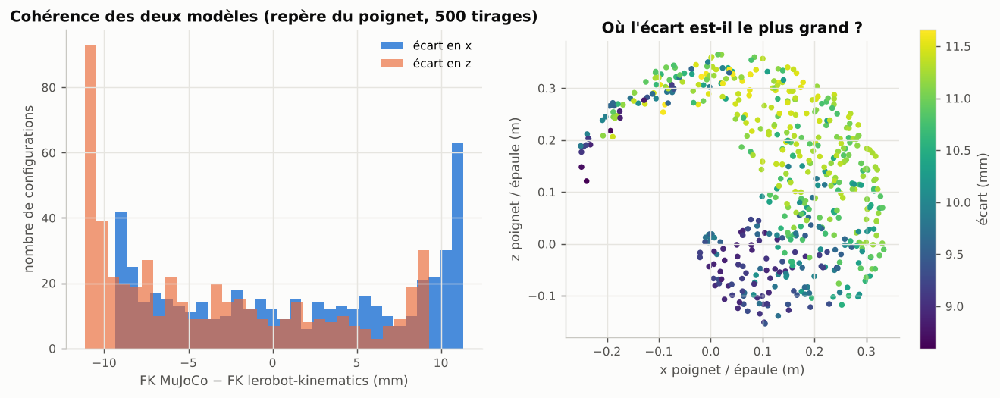

---

## 2. Découverte : `lerobot_IK` « réussit » sans bouger pour les petits déplacements

### 2.1 Le symptôme, dans notre propre script

`pid_ik_sim.py` demande un déplacement de **+2 cm vers l'avant et +2 cm vers le haut**. Sa
propre sortie :

```
IK success : True
Erreur IK seule [mm] : 28.28427124746191
Angles de consigne (IK) : [-3.14  3.14  0.   -1.57]      <- identiques à la pose de départ
Erreur finale de position de l'effecteur : 28.28 mm
```

28.28 mm = √(20² + 20²) : **l'IK n'a rien fait**, tout en renvoyant `success = True`, et le
PID a parfaitement suivi… une consigne fausse.

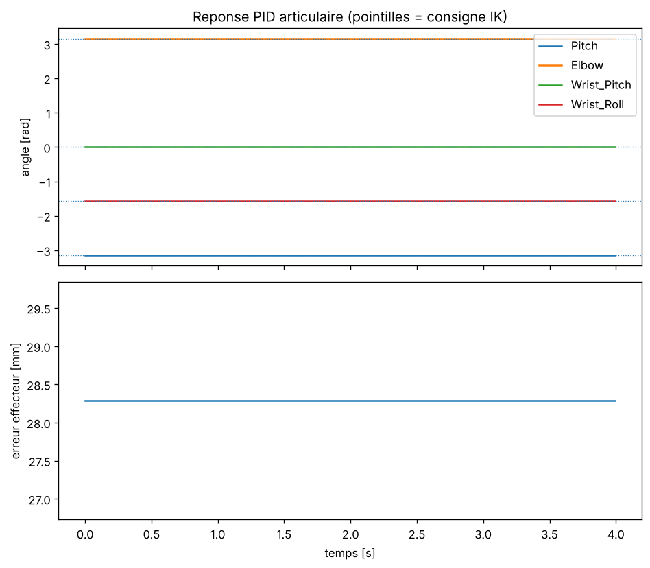

### 2.2 La cause, dans le code C++ de la bibliothèque

`lerobot_IK` appelle `robot.ikine_LM(Tep, q0, ilimit=10, slimit=2, tol=1e-3)`. Dans
`lerobot_kinematics/core/ik.cpp`, la boucle de Levenberg-Marquardt calcule **avant toute
itération** :

```cpp
_angle_axis(Te, Tep, e);              // erreur de pose 6D (m, rad)
*E = 0.5 * e.transpose() * We * e;     // erreur QUADRATIQUE
if (*E < tol) { /* We have arrived */ }
```

Avec `tol = 1e-3`, une erreur de **position seule** passe le test dès que
$\tfrac12\|e\|^2 < 10^{-3}$, c'est-à-dire $\|e\| < \sqrt{2\cdot10^{-3}} \approx$ **45 mm**. Tout
déplacement de moins de ~4.5 cm est donc déclaré « atteint » sans calcul. Le seuil était
probablement pensé comme une distance (1 mm), alors que c'est un carré.

### 2.3 Conséquences sur nos scripts

| Script | Effet du seuil de 45 mm |
|---|---|
| `pid_ik_sim.py` | consigne inchangée, erreur finale 28.3 mm (ci-dessus) |
| `pid_ik_real.py` | waypoints de 2–3 cm : le bras **ne devrait pas bouger** (prédiction : même IK, même amplitude — à vérifier sur le banc). Le script est de plus écrit pour le modèle **SO-100** (`get_robot('so100')`, pose `init_qpos` du SO-100) : à adapter au SO-101 |
| `pick_place_trajectoire_LQR.py` | `solve_ik` approche la cible par petits pas (< 45 mm chacun) : l'IK s'arrête trop tôt, erreur finale **32.4 mm > 5 mm** → `ValueError` dans `build_waypoints` (vérifié en simulation, [chapitre Q7](06_pick_and_place.md)) |
| `pick_place_astar.py` | **non concerné** : IK propre sur le modèle MuJoCo (moindres carrés amortis) |

### 2.4 Correctif et vérification

[`ik_precise.py`](../partie2_so101/ik_precise.py) fait le même appel avec `tol = 1e-10`
(≈ 0.01 mm), plus d'itérations, et le lissage à 0.1 rad devient optionnel. Il suffit de
remplacer l'import : `from ik_precise import lerobot_IK_precis as lerobot_IK`.

| Test (60 cibles atteignables tirées au hasard) | Réussite (< 5 mm) | Remarque |
|---|---|---|
| `lerobot_IK` appelé jusqu'à 60 fois | 33 % | médiane : pas de convergence en 60 appels |
| `solve_ik` de nos scripts (40 sous-cibles) | 48 % | 23 ms par appel |
| **`lerobot_IK_precis`, 1 seul appel** | **73 %** | médiane 0.0014 mm ; les échecs restants = minima locaux / butées depuis q = 0 |

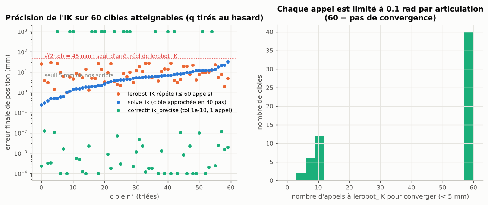

Même `pid_ik_sim.py`, IK corrigée : consigne `[-2.722, 2.895, -0.173, -1.57]`, **erreur finale
0.46 mm** au lieu de 28.28 mm.

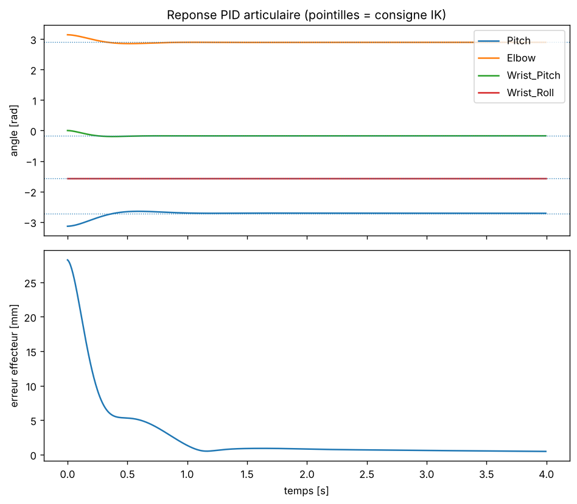

---

## 3. PID piloté par l'IK (`pid_ik_sim.py` / `pid_ik_real.py`)

### 3.1 Structure

```
cible cartésienne --IK--> angles de consigne q_ref --PID--> couple τ --modèle J q'' = τ − b q'--> q
                                                                         └--FK--> erreur effecteur
```

Le modèle par articulation $J\ddot q = \tau - b\dot q$ est une **hypothèse** (le script le dit) :
J = [0.05, 0.04, 0.02, 0.01], b = [0.20, 0.15, 0.08, 0.04]. PID discret à 5 ms, saturation
±1.5, anti-windup ±0.5, dérivée sur l'erreur sans « coup de dérivée » au premier pas
(`prev_err = None`).

### 3.2 Analyse en pôles

Le polynôme caractéristique en boucle fermée est $J s^3 + (b + K_d) s^2 + K_p s + K_i = 0$ :

| Articulation | pôles (Kp = 2, Ki = 0.5, Kd = 0.15) | pôle dominant |
|---|---|---|
| Pitch | −3.37 ± 5.19j, **−0.26** | constante de temps 3.8 s |
| Elbow | −3.62 ± 5.92j, **−0.26** | 3.8 s |
| Wrist_Pitch | −5.62 ± 8.09j, **−0.26** | 3.9 s |
| Wrist_Roll | −9.37 ± 10.36j, **−0.26** | 3.9 s |

Le pôle lent **≈ −Ki/Kp = −0.25** est le même pour toutes les articulations : c'est le zéro
introduit par l'action intégrale, presque compensé, qui laisse une **queue lente de ~4 s**. Pour
un modèle sans gravité ni frottement sec, l'intégrale n'a rien à compenser : elle ne fait que
ralentir la fin du mouvement.

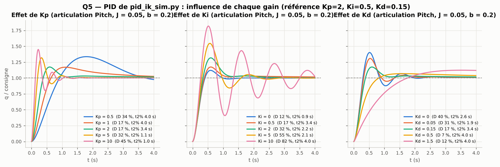

| Gain (articulation Pitch) | dépassement | temps de réponse à 2 % |
|---|---|---|
| référence Kp = 2, Ki = 0.5, Kd = 0.15 | 17 % | 3.35 s |
| **Ki = 0** | 12 % | **0.91 s** |
| Kp = 5 | 32 % | 1.11 s |
| Kd = 0 | 40 % | 2.62 s |
| Kd = 0.5 | 7 % | > 4 s (sur-amorti) |
| Ki = 5 | 55 % | 2.09 s |

### 3.3 Ce que `pid_ik_real.py` fait vraiment sur le bras

Le commentaire du script le dit honnêtement : *« le PID ne lit PAS la position réelle du bras »*.
Le PID tourne sur le modèle simulé (`SUBSTEPS = 4` pas de 5 ms par envoi à 50 Hz) et sert de
**générateur de trajectoire lisse** ; la vraie boucle fermée est l'asservissement interne des
servos STS3215. Nos LQR font exactement la même chose (chapitres suivants) : ce sont des
**filtres de consigne optimaux**, pas des régulateurs de la position mesurée. La
comparaison « PID vs LQR » sur le bras porte donc sur la **qualité des consignes**
(douceur, respect des limites), pas sur le rejet de perturbation. Une vraie boucle externe
sur la mesure est discutée au [chapitre Q8](07_evitement_obstacles.md#5-aller-plus-loin).

---

## 4. Bras 2D, multi-DDL puis 3D avec pyro (« testez des modèles 2D avant la 3D »)

Modèles dynamiques complets de pyro : $H(q)\ddot q + C(q,\dot q)\dot q + g(q) + d(\dot q) = \tau$.

### 4.1 Bras plan 2 DDL : FK/IK + trois contrôleurs

Cible cartésienne (0.45, 0.35) m → IK de Newton sur le jacobien pyro `robot.J(q)` →
$q_d$ = [0.356, 1.621] rad, puis :

* **a. PID articulaire** (`pyro.control.robotcontrollers.JointPID`) ;
* **b. LQR sur le modèle linéarisé** autour de $(q_d, 0)$ avec $u_{bar} = g(q_d)$
  (`pyro.dynamic.statespace.linearize` + `synthesize_lqr_controller(ss, cf, xbar, ubar)`) ;
* **c. couple calculé + LQR** : $\tau = H(q)\,v + C\dot q + g + d$ avec $v = -K x$ ⇒ $\ddot q = v$.
  C'est **exactement** le modèle double intégrateur « $\dot x = Ax + Bu$ » de nos scripts SO-101.

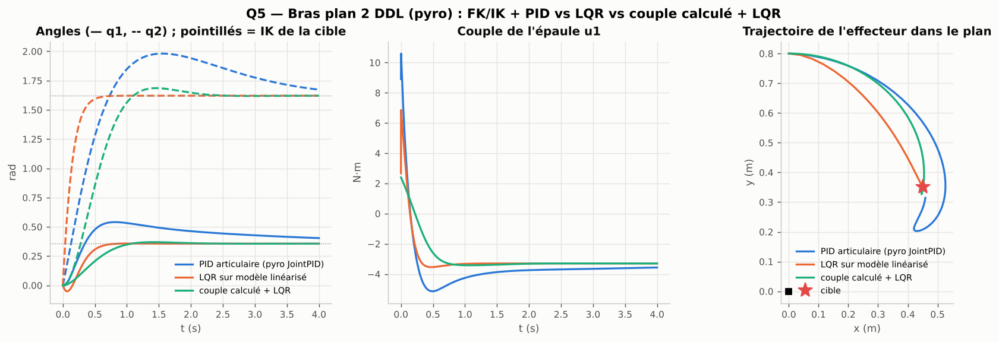

| Contrôleur | erreur effecteur à t = 4 s | entrée dans ±0.02 rad | couple max |
|---|---|---|---|
| PID articulaire (pyro) | 39.2 mm | > 4 s | 10.6 N·m |
| LQR linéarisé | **0.00 mm** | **0.62 s** | 14.4 N·m |
| couple calculé + LQR (Q = 100, R = 1) | 0.03 mm | 2.08 s | **3.4 N·m** |

* Le **PID** dépasse largement (q2 monte à 1.98 rad pour une cible à 1.62) puis converge
  lentement : la gravité est compensée par l'intégrale, donc tardivement.
* Le **LQR linéarisé** est le plus rapide mais n'est valable qu'autour de $q_d$ : partant de 0,
  il fonctionne ici car le modèle reste « assez linéaire » ; pour un grand mouvement il faut
  re-linéariser (ou couple calculé).
* Le **couple calculé + LQR** donne un comportement **identique partout** (second ordre
  $\omega_n = (Q/R)^{1/4}$) et un couple faible, mais **suppose un modèle exact** de $H$, $C$, $g$.

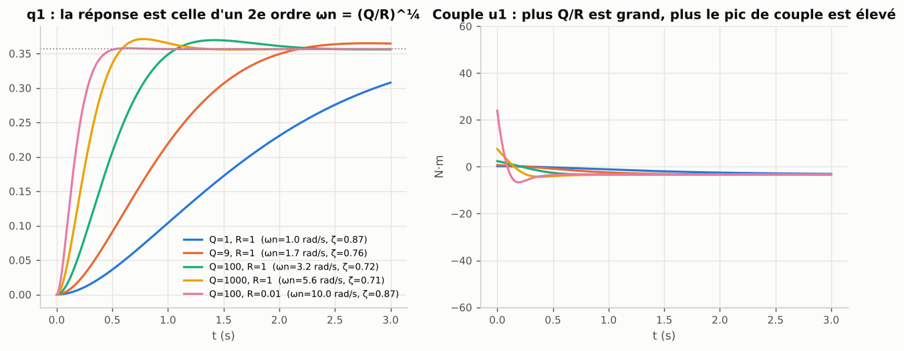

### 4.2 Bras plan 5 DDL (redondant) et bras 3D

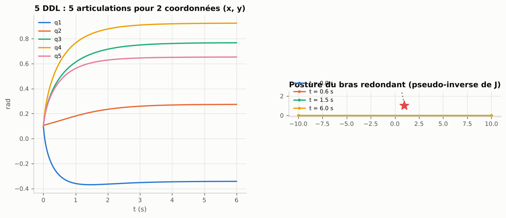

5 articulations pour 2 coordonnées : le contrôleur cinématique pyro
($\dot q = J^+ k\,(r_d - r)$) choisit, parmi une infinité de postures, celle de norme minimale
des vitesses. Erreur finale 3.7 mm après 6 s (convergence exponentielle, gain 1). C'est le
même problème que l'IK du SO-101 quand on ne fixe pas l'orientation de la pince (4 articulations
pour 3 coordonnées) : il faut choisir une posture.

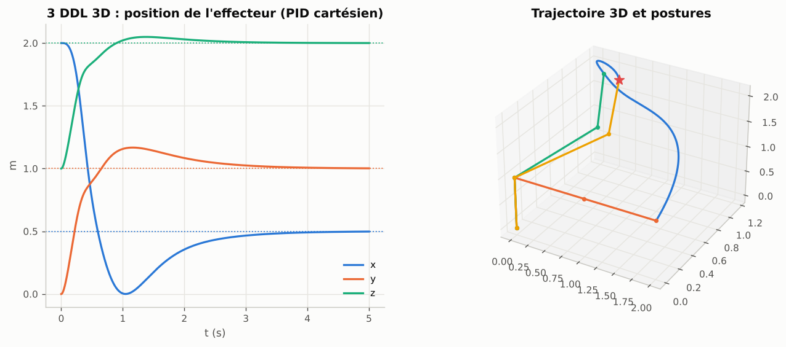

Bras 3 DDL en 3D (pyro `ThreeLinkManipulator3D`) avec un PID **cartésien** (erreur exprimée sur
l'effecteur, couple $\tau = J^T F$) : erreur finale 3.0 mm à 5 s.

### 4.3 Le bras 2D dessine l'étoile (préparation de Q6)

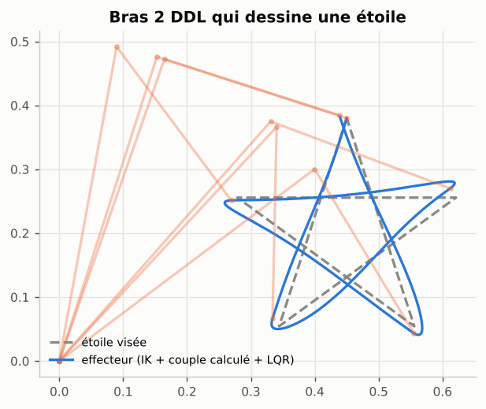

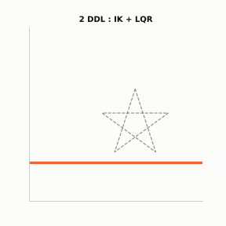

IK point par point + couple calculé + LQR (Q = 400) avec anticipation de vitesse : écart moyen
9.5 mm (max 25.5 mm aux pointes, où la consigne change brutalement de direction).

---

## 5. Réflexion

* **Toujours vérifier l'IK par la FK** : `pid_ik_sim.py` le faisait (il affiche l'erreur
  28.28 mm) — c'est ce réflexe qui a permis de trouver le défaut. Un `success = True` ne suffit pas.
* **2D avant 3D** : sur le bras 2 DDL on voit en 5 s de simulation ce qui serait coûteux à
  découvrir sur le vrai bras : le PID dépasse, le LQR linéarisé n'est valable que localement,
  le couple calculé dépend du modèle.
* **Sur le SO-101, le « modèle » du LQR est volontairement simple** (double intégrateur) parce
  que les servos ferment déjà la boucle de position : on n'a pas accès au couple. Le jumeau
  MuJoCo ([méthodologie](00_methodologie.md)) sert à mesurer ce que cette simplification coûte.
