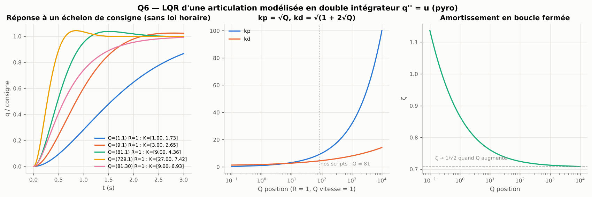
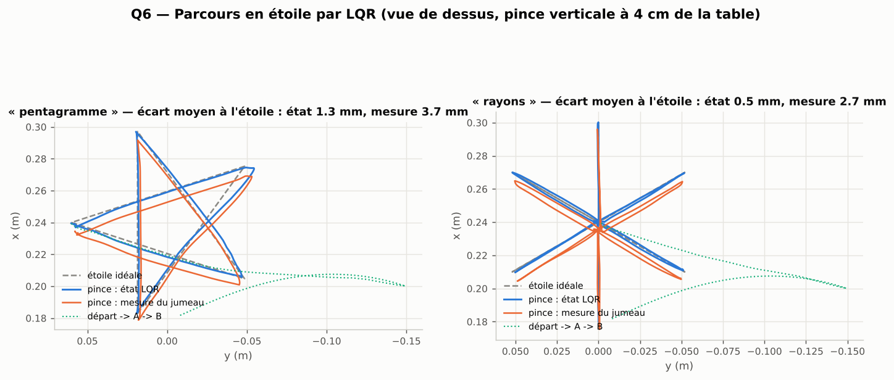
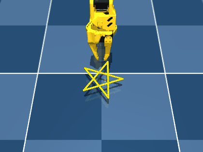
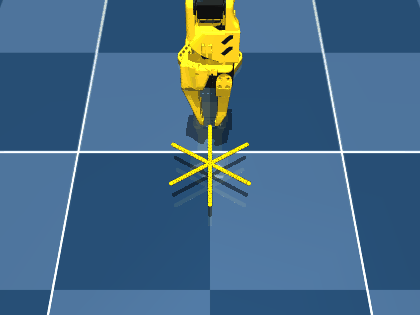
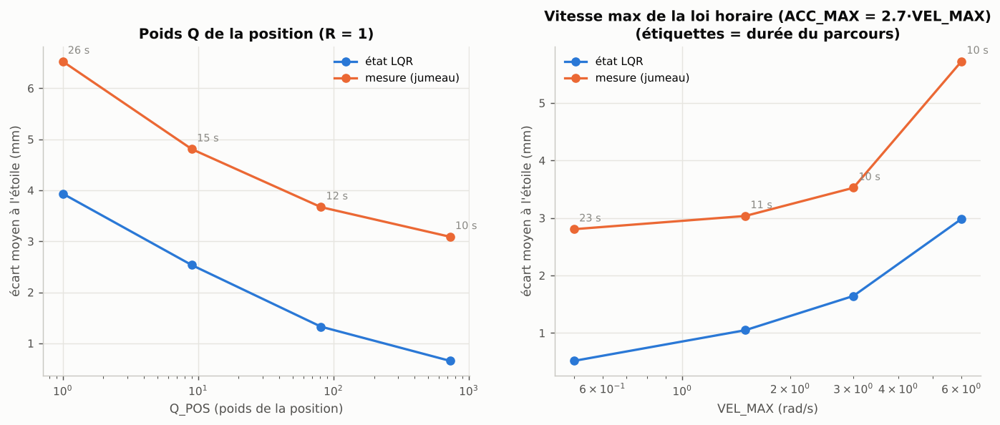

# Partie 2 — Q6 : LQR d'un point A à un point B, puis parcours en étoile

> [← Q5](04_cinematique_PID_LQR.md) · [Sommaire](../README.md) · [Q7 : pick & place →](06_pick_and_place.md)
>
> **Statut : simulation + jumeau numérique.** Le script [`lqr_etoile.py`](../partie2_so101/lqr_etoile.py)
> a un `MODE = "real"` prêt pour le bras ; les vidéos réelles sont à ajouter dans
> [media/](../media/README.md#q6--a--b-et-étoile).

Code : [`partie2_so101/lqr_etoile.py`](../partie2_so101/lqr_etoile.py) (nouveau),
étude [`simulations/s5_etoile.py`](../simulations/s5_etoile.py) et
[`s4_lqr_pick_place.py`](../simulations/s4_lqr_pick_place.py) (partie théorique).

---

## 1. Le LQR utilisé sur le SO-101 : un double intégrateur par articulation

Les servos acceptent une **position**. On modélise chaque articulation par $\ddot q = u$ :

```math
x = \begin{bmatrix} q_{1..6} \\ \dot q_{1..6} \end{bmatrix}, \quad
A = \begin{bmatrix} 0 & I_6 \\ 0 & 0 \end{bmatrix}, \quad
B = \begin{bmatrix} 0 \\ I_6 \end{bmatrix}, \quad
u = K\,(x_{ref}(t) - x) + \ddot q_{ref}(t)
```

$K$ est calculé par pyro (`synthesize_lqr_controller`) à partir des matrices $Q$ (12×12) et
$R$ (6×6) écrites **en clair** dans nos scripts. Comme $Q$ et $R$ sont diagonales, le problème
se découple : pour chaque articulation, avec $Q = \mathrm{diag}(q_p, q_v)$ et $R = r$ :

```math
k_p = \sqrt{q_p/r}, \qquad k_d = \sqrt{q_v/r + 2\sqrt{q_p/r}}, \qquad
\omega_n = (q_p/r)^{1/4}, \qquad \zeta = \frac{k_d}{2\,\omega_n}
```

Nos scripts utilisent $q_p = 81$, $q_v = 1$, $r = 1$ : **K = [9, 4.359]**, $\omega_n$ = 3 rad/s,
$\zeta$ = 0.73 (vérifié : c'est la matrice K affichée par les scripts).



| Q position | Q vitesse | R | kp | kd | ωn | ζ | temps de réponse 5 % (échelon) |
|---|---|---|---|---|---|---|---|
| 1 | 1 | 1 | 1.00 | 1.732 | 1.00 | 0.866 | ≥ 3 s |
| 9 | 1 | 1 | 3.00 | 2.646 | 1.73 | 0.764 | 1.83 s |
| **81** | **1** | **1** | **9.00** | **4.359** | **3.00** | **0.726** | **0.99 s** |
| 729 | 1 | 1 | 27.00 | 7.416 | 5.20 | 0.714 | 0.56 s |
| 81 | 30 | 1 | 9.00 | 6.928 | 3.00 | 1.155 | 1.95 s |

Deux propriétés utiles pour régler sans tâtonner :
* multiplier $q_p$ par 81 accélère d'un facteur 3 (racine quatrième) ;
* quand $q_p$ grandit, $\zeta \to 1/\sqrt2$ : le LQR « tend » vers un réglage de Butterworth ;
  pour un mouvement sans dépassement il faut augmenter $q_v$ (dernière ligne, ζ > 1).

**Pourquoi une loi horaire en plus du LQR ?** Sur un échelon, le LQR seul demande une
accélération initiale $k_p \cdot \Delta q$ (9 rad/s² par radian d'écart) : violent pour un grand
déplacement. Nos scripts génèrent donc une **consigne** $q_{ref}(t)$ avec le profil polynomial
$s(\tau) = 3\tau^2 - 2\tau^3$ (vitesse nulle aux extrémités), de durée

```math
T = \max\left(0.3,\ \frac{1.5\,D}{v_{max}},\ \sqrt{\frac{6\,D}{a_{max}}}\right)
```

car ce profil atteint une vitesse maximale $1.5D/T$ et une accélération maximale $6D/T^2$.
Avec l'anticipation $\ddot q_{ref}$, le LQR ne corrige plus que les écarts : il sert de
« ressort amorti » autour de la consigne.

---

## 2. A → B en ligne droite puis parcours en étoile

`lqr_etoile.py` enchaîne : pose de départ → **A** (articulaire) → **B** = premier sommet
(**ligne droite cartésienne**) → l'étoile. Chaque segment est une ligne droite de la pince,
pince **verticale**, convertie en angles tous les 5 mm par l'IK MuJoCo à priorités
(`ArmPlanner.joint_path`). Le segment s'arrête à chaque sommet (les angles de l'étoile sont
vifs : une vitesse non nulle au sommet couperait la pointe).

Le TD dit « faites un parcours en étoile » ; nous avons implémenté les **deux lectures** :

| `PATTERN` | Parcours | Intérêt |
|---|---|---|
| `"pentagramme"` | étoile à 5 branches {5/2}, sommets 0→2→4→1→3→0, rayon 6 cm | 5 lignes droites qui se croisent : teste la précision cartésienne |
| `"rayons"` | depuis un centre C : C→P1→C→P2→… (6 branches) | aller-retour A→B répétés dans 6 directions : teste la répétabilité |



| Rendu MuJoCo (trace verte = pince, jaune = consigne) | |
|---|---|
|  |  |

| Parcours | durée | écart moyen à l'étoile : état LQR | mesure du jumeau (max) | affaissement vertical moyen |
|---|---|---|---|---|
| pentagramme | 11.8 s | 1.3 mm | 3.7 mm (8.4 mm) | −7.6 mm |
| rayons | 17.8 s | 0.5 mm | 2.7 mm (6.8 mm) | −7.0 mm |

**Lecture concrète.**

1. **L'état LQR suit l'étoile au millimètre** (1.3 mm) : la chaîne IK + loi horaire + LQR est
   cohérente.
2. La **mesure** du jumeau (servos MuJoCo avec gravité) s'écarte de 3–4 mm dans le plan et
   surtout de **−7.5 mm en hauteur** : c'est l'**affaissement statique** d'un asservissement
   proportionnel sous la gravité ($\Delta q = \tau_g / k_p$, avec $k_p$ = 17.8 N·m/rad dans le
   modèle). Aucun réglage du LQR ne peut corriger cela, puisque le LQR ne voit pas la mesure.
3. Le **segment A → B** (pointillés verts) n'est **pas droit** pour l'état LQR alors que le
   chemin articulaire l'est (écart au segment < 0.5 mm, vérifié) : sur ce long segment la
   commande sature, l'état « coupe » la trajectoire. Analyse et correctif au
   [chapitre améliorations](10_ameliorations.md).

---

## 3. Influence des réglages : Q et vitesse maximale (« speed control »)



| Réglage | durée | écart moyen état | écart max état | écart moyen mesure | écart max mesure |
|---|---|---|---|---|---|
| Q_POS = 1 | 26.0 s | 3.9 mm | 21.7 mm | 6.5 mm | 21.4 mm |
| Q_POS = 9 | 15.4 s | 2.5 mm | 13.3 mm | 4.8 mm | 13.8 mm |
| **Q_POS = 81** | **11.8 s** | **1.3 mm** | **6.4 mm** | **3.7 mm** | **8.4 mm** |
| Q_POS = 729 | 9.9 s | 0.7 mm | 3.0 mm | 3.1 mm | 7.2 mm |
| VEL_MAX = 0.5 rad/s | 23.5 s | 0.5 mm | 3.6 mm | 2.8 mm | 8.0 mm |
| VEL_MAX = 1.5 rad/s | 11.5 s | 1.0 mm | 4.8 mm | 3.0 mm | 7.9 mm |
| VEL_MAX = 3 rad/s | 10.3 s | 1.6 mm | 8.9 mm | 3.5 mm | 12.3 mm |
| VEL_MAX = 6 rad/s | 10.0 s | 3.0 mm | 17.7 mm | 5.7 mm | 17.5 mm |

* **Q_POS** agit surtout sur **la durée** (condition d'arrivée `POS_TOL` atteinte plus vite) et
  sur la précision de l'état ; la précision **mesurée** plafonne à ~3 mm (servos + gravité).
* **VEL_MAX** est le vrai « bouton vitesse » : de 1.5 à 6 rad/s on gagne seulement 1.5 s
  (la durée est dominée par les arrêts aux sommets et les pauses `HOLD`) mais l'erreur
  maximale est multipliée par 2.2. Réglage retenu : 1.5 rad/s.

---

## 4. Réflexion

* Le LQR « double intégrateur » est un **lisseur de consigne optimal** ; la précision finale
  est fixée par la mécanique (affaissement, jeu) et par la qualité de la consigne (IK, loi
  horaire), pas par Q/R au-delà de Q ≈ 81.
* Pour corriger l'affaissement il faudrait **fermer une boucle sur la mesure** (intégrateur
  externe sur `arm.feedback()`), ou compenser la gravité en ajoutant $\tau_g/k_p$ à la consigne :
  piste détaillée au [chapitre améliorations](10_ameliorations.md).
* Sur le vrai bras, filmer l'étoile vue de dessus (stylo dans la pince) donnerait directement
  l'erreur réelle à comparer aux 3.7 mm du jumeau → [media/](../media/README.md).
