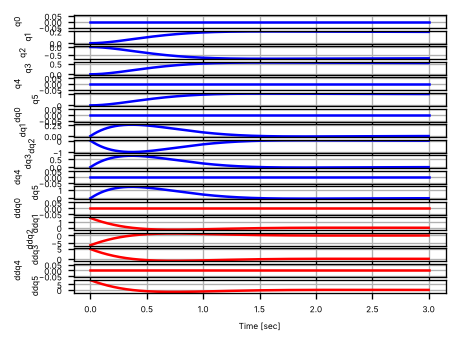
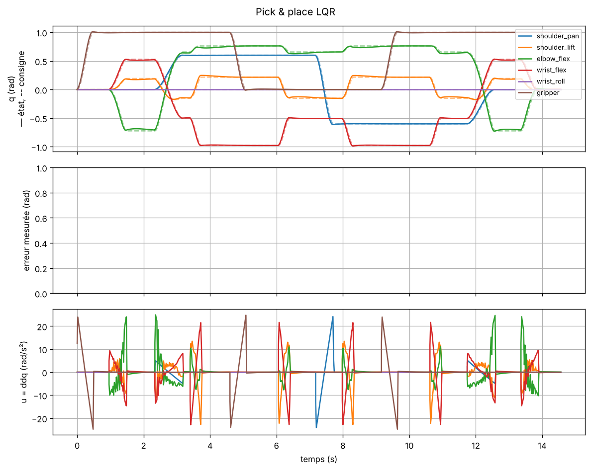
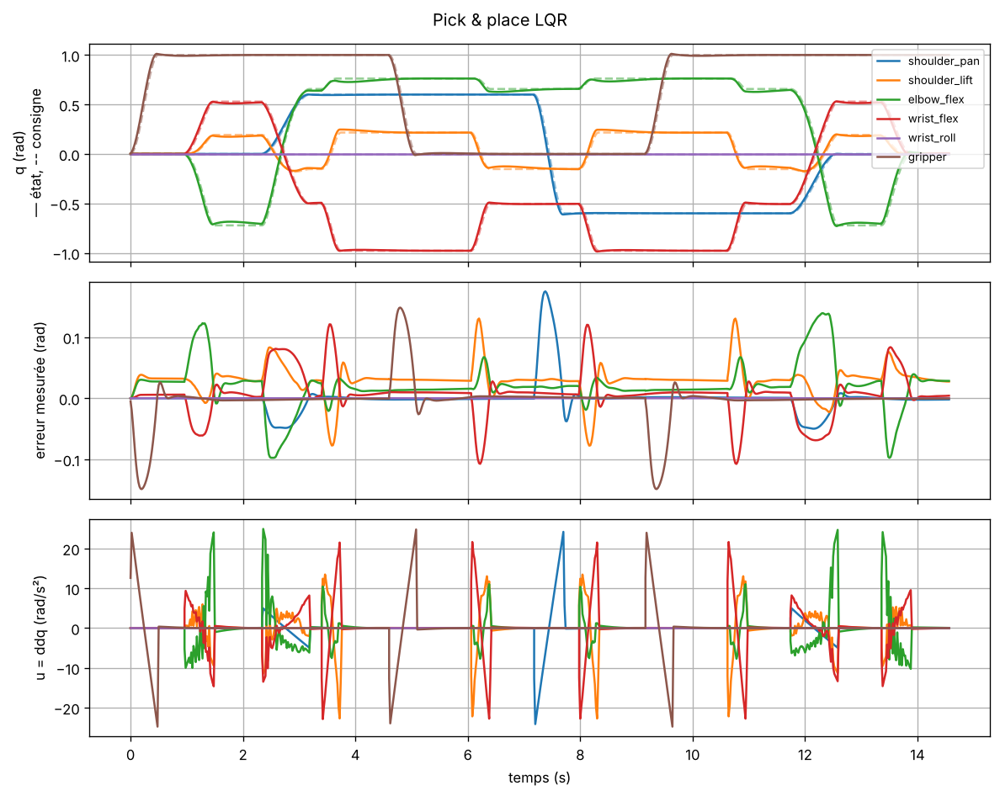
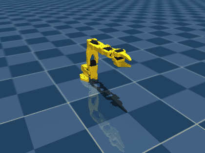
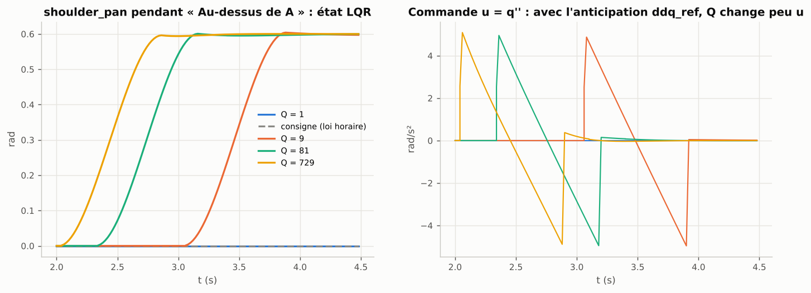

# Partie 2 — Q7 : prendre un objet en A et le déposer en B (reaching)

> [← Q6](05_LQR_A_B_etoile.md) · [Sommaire](../README.md) · [Q8 : obstacles →](07_evitement_obstacles.md)
>
> **Statut : réel (version A*, voir Q8) + simulation / jumeau (version 1, ci-dessous).**

Code : [`pick_place_trajectoire_LQR.py`](../partie2_so101/pick_place_trajectoire_LQR.py) (version 1,
original), [`pick_place_astar.py`](../partie2_so101/pick_place_astar.py) (version 2, chapitre Q8),
étude [`simulations/s4_lqr_pick_place.py`](../simulations/s4_lqr_pick_place.py).

---

## 1. La séquence et sa logique

Les deux versions enchaînent les mêmes 12 étapes, **toutes relatives à la position de départ
mesurée** (`q0 = arm.feedback()`) : le bras n'est jamais envoyé brutalement vers une pose de repos.

```
Ouvrir la pince → Lever (départ) → Au-dessus de A → Descente sur A → Fermer la pince (A)
→ Remonter de A → Au-dessus de B → Descente sur B → Ouvrir la pince (B) → Remonter de B
→ Au-dessus du départ → Retour au départ
```

Algorithme de chaque étape (version 1) :

```
q_fin   ← IK(cible cartésienne)                       # lerobot-kinematics
chemin  ← cart_path(q_prev, q_fin) : IK tous les 5 mm le long du segment cartésien
          (pan interpolé linéairement, orientation de la pince conservée)
ref     ← Reference(chemin) : s(τ) = 3τ² − 2τ³, T = max(0.3, 1.5·m·dq/VEL_MAX, √(6·m·dq/ACC_MAX))
boucle 50 Hz :
    (q_r, dq_r, ddq_r) ← ref(t)                       # différences finies, h = 10 ms
    u ← clip(K (x_ref − x) + ddq_r, ±1.5·ACC_MAX)      # LQR pyro
    x ← intégration d'Euler (dq saturé à ±1.5·VEL_MAX)
    envoyer x[:6] (MuJoCo et/ou servos) ; lire la mesure ; arrêt si |mesure − x| > 0.5 rad pendant 0.5 s
    étape finie si t ≥ T, |x − q_fin| < POS_TOL, |dq| < 0.05, puis maintien HOLD
```

**Choix concrets à souligner dans le code :**

| Élément | Ligne(s) | Commentaire |
|---|---|---|
| Descente/remontée **verticales** en cartésien | `cart_path`, `PATH_STEP = 0.005` | la pince ne traverse jamais la table, quelle que soit la vitesse des articulations ; interpoler en articulaire ferait un arc |
| Loi horaire de degré 3 | `Reference` | vitesse nulle au départ et à l'arrivée ; la durée respecte VEL_MAX et ACC_MAX *en ordre de grandeur* (`m·dq` majore la longueur) |
| Pince traitée comme une 6ᵉ articulation | `GRIP_OPEN = 1.0`, `GRIP_CLOSED = 0.0` | même LQR : ouverture/fermeture douces |
| Garde de sécurité | `TRACK_ERR_MAX = 0.5` rad pendant 0.5 s, pince exclue | arrêt si le bras réel ne suit plus (collision, blocage) ; la pince est exclue car serrer un objet crée volontairement un écart |
| Démarrage sans saut | `Goal_Position = q0` puis `Torque_Enable = 1` | aucun mouvement à l'activation du couple |
| Mode `teach` | `teach()` | couple coupé, on montre A et B à la main : pas d'erreur de modèle sur les points |

---

## 2. Exécution du script original en simulation

### 2.1 Tel quel : échec à cause de l'IK

```
ValueError: IK : cible [0.22 0.   0.06] non atteinte (erreur 32.4 mm). Point hors de portée ? Change x/z.
```

Le point est atteignable : c'est le seuil de 45 mm de `lerobot_IK` décrit au
[chapitre Q5](04_cinematique_PID_LQR.md#2-découverte--lerobot_ik--réussit--sans-bouger-pour-les-petits-déplacements)
qui fait s'arrêter `solve_ik` trop tôt. La vérification `err > 5e-3` du script a bien fait son
travail : sans elle, le bras serait parti 3 cm à côté de l'objet.

### 2.2 Avec le correctif `ik_precise` (aucune autre modification)

| Étape | points du chemin | durée | q_fin |
|---|---|---|---|
| Lever (départ) | 13 | 0.5 s | [0, 0.193, −0.722, 0.529, 0, 1] |
| Au-dessus de A | 41 | 0.8 s | [0.6, −0.153, 0.657, −0.504, 0, 1] |
| Descente sur A | 14 | 0.3 s | [0.6, 0.216, 0.762, −0.978, 0, 1] |
| Au-dessus de B | 54 | 0.5 s | [−0.6, −0.153, 0.657, −0.504, 0, 0] |

*(extrait ; les 12 étapes durent 14.6 s au total avec les maintiens.)*

Réponse indicielle LQR calculée par pyro (affichée par le script avant le mouvement,
`SHOW_PYRO_STEP = True`) puis journal de la séquence en simulation pure :

| Réponse indicielle pyro | Journal (simulation) |
|---|---|
|  |  |

### 2.3 Sur le jumeau numérique (servos MuJoCo + gravité)





* Commande u en **triangles** : c'est l'accélération du profil $s = 3\tau^2 - 2\tau^3$
  ($\ddot s \propto 6 - 12\tau$, linéaire). Les pointes valent ±25 rad/s² = `ACC_MAX` : quand la
  durée est fixée par la contrainte d'accélération ($T = \sqrt{6D/a_{max}}$), le pic du profil vaut
  exactement $a_{max}$ (la saturation à `1.5·ACC_MAX` = 37.5 n'est pas atteinte).
* Erreur mesurée max 0.175 rad (pan) pendant les grands mouvements, **erreur statique de
  l'épaule +0.03 rad** (gravité, voir Q6) ; pince : ±0.15 rad à l'ouverture/fermeture (la
  pince va moins vite que la consigne).

---

## 3. Influence de Q sur la séquence complète (jumeau)



| Q position | durée totale | max\|x − consigne\| | max\|mesure − x\| | max\|u\| |
|---|---|---|---|---|
| 1 | 33.6 s | 0.093 rad | 0.173 rad | 24.6 |
| 9 | 20.2 s | 0.081 rad | 0.174 rad | 24.7 |
| **81** | **14.6 s** | 0.085 rad | 0.175 rad | 24.9 |
| 729 | 12.3 s | 0.088 rad | 0.175 rad | 25.7 |

Résultat net : **avec l'anticipation $\ddot q_{ref}$, Q ne change presque pas le suivi**
(0.08–0.09 rad) ni l'erreur mesurée (0.175 rad, fixée par les servos). Il change la **durée**
(33.6 s → 12.3 s) parce que chaque étape attend que l'état soit à `POS_TOL` = 0.02 rad de la
cible : avec Q = 1 ($\omega_n$ = 1 rad/s) cette convergence finale prend plusieurs secondes.

---

## 4. Prendre vraiment l'objet : ce qui n'est pas dans le code

* **Hauteur de saisie** : A et B sont à z = 0.02 m (repère MuJoCo) ou appris en `teach`. Avec
  le mode `teach`, la position est exacte (mêmes angles), ce qui rend le pick & place réel
  bien plus fiable que des coordonnées théoriques (voir l'écart FK de ~7 mm entre modèles, Q5).
* **Effort de serrage** : la pince est commandée en position (0 = fermée). Sur un objet, le
  servo n'atteint pas 0 : l'écart consigne/mesure *est* la force de serrage (servo
  proportionnel). C'est pourquoi la garde de sécurité exclut la pince. Sur le graphe réel
  (chapitre Q8), l'erreur de la pince revient vers 0 après la fermeture : l'objet était
  soit très souple, soit non saisi — **à vérifier sur la vidéo**.
* Une amélioration simple : lire `Present_Current` (ou `Present_Load`) du servo de pince pour
  **détecter** la saisie et refaire la prise si la charge reste nulle.

**Vidéos à ajouter** : pick & place réel (vue de côté + vue de dessus) →
[media/README.md](../media/README.md#q7--pick--place).
