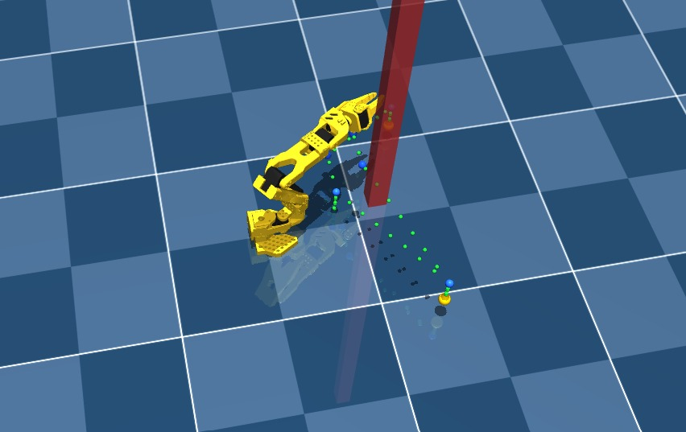
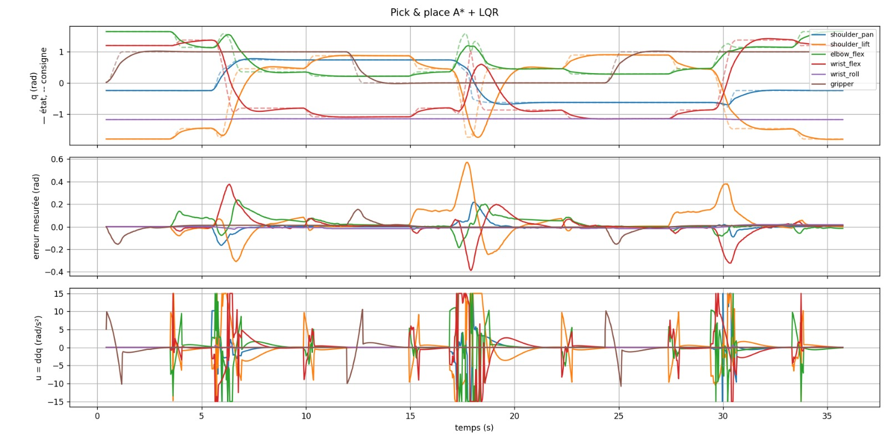
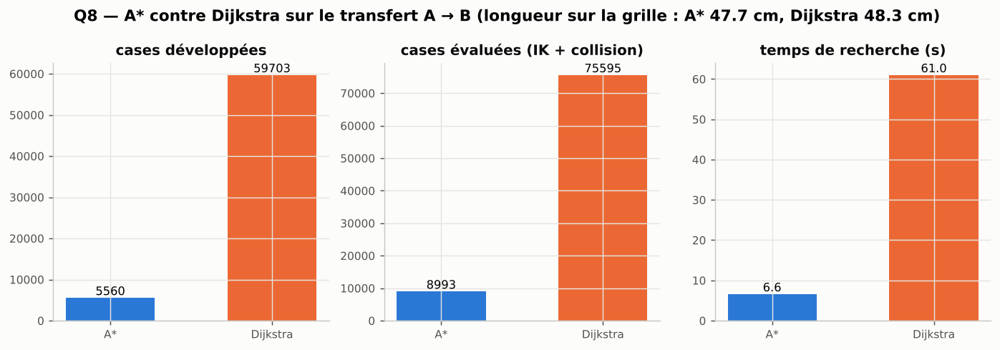
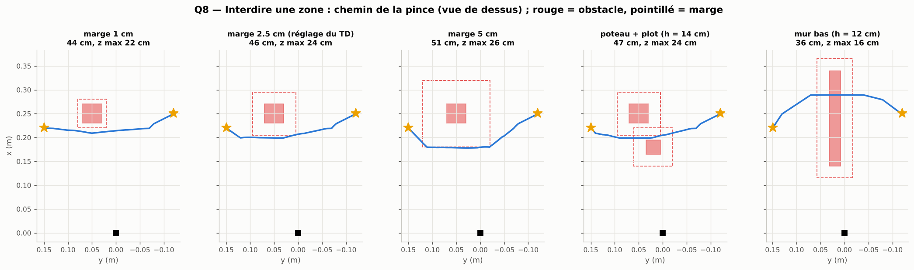
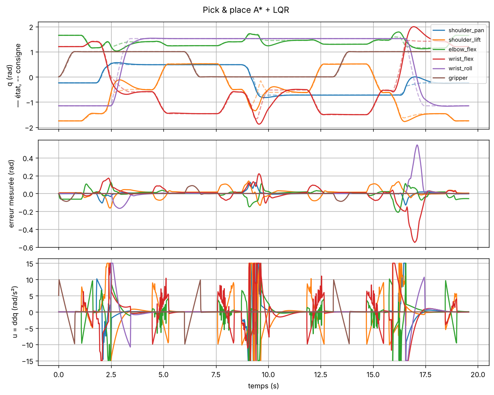
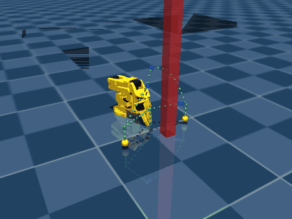
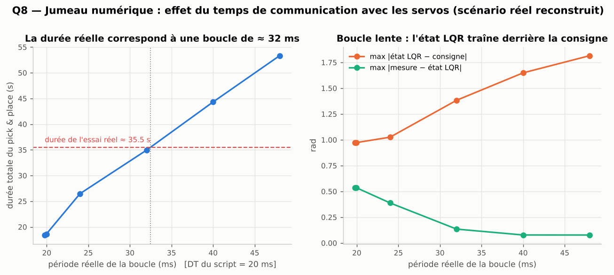
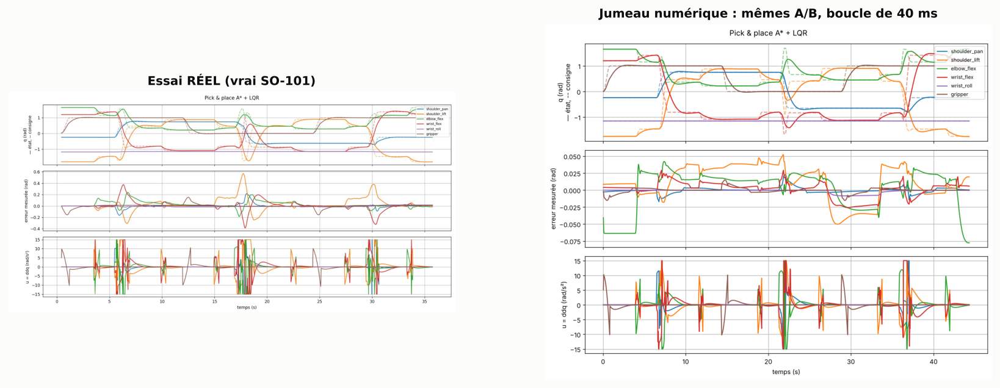

# Partie 2 — Q8 : interdire une zone — planification A* + suivi LQR, et analyse de l'essai réel

> [← Q7](06_pick_and_place.md) · [Sommaire](../README.md) · [Bonus RRT →](08_bonus_RRT.md)
>
> **Statut : RÉEL** (graphe et capture MuJoCo de l'essai sur le vrai SO-101) **+ jumeau
> numérique** pour expliquer ce graphe.

Code : [`pick_place_astar.py`](../partie2_so101/pick_place_astar.py) (original),
[`astar_planner.py`](../partie2_so101/astar_planner.py) (**reconstruit**, voir l'encadré),
étude [`simulations/s6_astar_obstacles.py`](../simulations/s6_astar_obstacles.py).

> **À propos de `astar_planner.py`.** Le fichier original importé par `pick_place_astar.py`
> n'a pas été conservé. Nous l'avons ré-écrit en respectant **exactement l'interface et le
> principe décrits dans la docstring de `pick_place_astar.py`** (grille 3D de 1 cm, cases
> validées par IK + collisions MuJoCo, lissage par raccourcis). Les résultats chiffrés de
> planification de ce chapitre sont ceux de cette reconstruction ; le graphe réel, lui, a
> été obtenu avec le planificateur d'origine.

---

## 1. Ce qui est réellement fait sur le bras



*Capture de MuJoCo pendant l'essai réel : poteau rouge (obstacle virtuel de 4 × 4 cm, 2 m de
haut : on ne peut pas passer au-dessus), points verts = chemin de la pince, points bleus =
points A* lissés, jaunes = A et B.*



### 1.1 Lecture du graphe réel, panneau par panneau

**Haut — état LQR (trait plein) et consigne (pointillés).**
* Durée totale **≈ 35.5 s** pour 12 étapes ; pose de départ mesurée : pan −0.25, épaule −1.75,
  coude 1.65, poignet 1.2, rotation −1.15 rad (bras replié), pince fermée.
* Pendant les trois transferts A* (t ≈ 5.5–7 s, 17–19 s, 29.5–31 s), **l'état LQR est
  nettement en retard sur sa consigne** (jusqu'à ~0.5 s). Avec une boucle exactement à 50 Hz
  cela ne devrait pas arriver (le jumeau à 20 ms suit sa consigne, voir § 3). C'est l'indice
  principal qui nous a fait chercher du côté de la **vitesse réelle de la boucle**.
* A et B sont lus sur ce panneau : A ≈ [0.75, 0.88, 0.22, −1.08, −1.15] (pan à +0.75 rad),
  B ≈ [−0.65, 0.90, 0.45, −1.12, −1.15] (±0.05 rad) : c'est le scénario reconstruit au § 3.

**Milieu — erreur mesurée = position lue sur les servos − état LQR.**
* Erreurs **proportionnelles à la vitesse** : quasi nulles à l'arrêt (< 0.02 rad, les servos
  tiennent bien la position), grandes pendant les transferts.
* **Maximum 0.57 rad sur `shoulder_lift` à t ≈ 17.6 s**, pendant « A* → au-dessus de B » avec
  la pince fermée. La garde `TRACK_ERR_MAX = 0.5` rad est dépassée mais **pendant moins de
  0.5 s**, d'où l'absence d'arrêt : le délai de 0.5 s a évité un faux arrêt… mais montre aussi
  que la marge de sécurité est faible.
* `wrist_flex` ±0.38 rad, épaule −0.3 rad à t ≈ 6.7 s : l'épaule et le poignet portent le plus
  de couple de gravité et d'inertie.
* Pince : −0.15 rad à l'ouverture (t ≈ 1 s), +0.15 rad à la fermeture (t ≈ 12.7 s) puis retour à
  ~0 : le servo de pince est plus lent que la consigne ; après fermeture l'erreur revient à 0,
  donc **la pince a atteint « fermé » : objet très souple ou non saisi** (à confirmer sur la vidéo).

**Bas — commande u = q̈ du LQR.**
* Saturations répétées à **±15 rad/s² = 1.5·ACC_MAX** (ACC_MAX = 10) pendant les transferts A*,
  en « peigne » : ce sont les impulsions d'accélération de la consigne interpolée linéairement
  entre les points du chemin (différences finies sur une courbe anguleuse). Analyse et
  correctif : [chapitre améliorations](10_ameliorations.md).
* Pince : triangles de ±10 rad/s² : pour 1 rad d'ouverture, $T = \sqrt{6\cdot1/10} = 0.77$ s et
  le pic du profil vaut exactement ACC_MAX = 10 — cohérent avec le code.

---

## 2. Algorithme A* (tel que reconstruit)

```
A*(q_départ, q_but) :
  p0, p1 ← FK(q_départ), FK(q_but)              # bout de pince (site MuJoCo gripperframe)
  grille 3D de pas 1 cm, alignée sur p0 ; voisins = 26 directions
  g(p0) = 0 ;  OUVERT ← {p0} trié par f = g + h,  h(c) = ‖c − p1‖ (euclidienne, admissible)
  tant que OUVERT non vide :
      c ← case de plus petit f ; si c = p1 : fin
      pour chaque voisin v de c :
          valide(v) ?   (évaluée une seule fois, à la demande)
             - pince hors des obstacles gonflés de MARGIN (2.5 cm) et z ≥ table + CLEARANCE (3 cm)
             - IK MuJoCo (moindres carrés amortis) en partant de la configuration de c
             - aucune géométrie de collision du bras à moins de 6 mm d'un obstacle (mj_geomDistance)
          si g(c) + ‖v − c‖ < g(v) : g(v), parent(v) ← … ; ajouter v à OUVERT
  chemin ← remonter les parents ; LISSAGE : depuis le point courant, relier le point le plus
  lointain joignable en ligne droite (segment valide tous les 5 mm) ; configurations conservées
```

Deux idées clés :
* **la planification se fait dans l'espace de la pince (3D)** mais **chaque case est validée
  pour le bras entier** (5 corps de collision) : on évite que le coude ou le poignet heurtent
  le poteau même quand la pince passe à côté ;
* **évaluation paresseuse** : sur ~150 000 cases possibles dans l'espace de travail, A* n'en
  évalue que quelques milliers.

### 2.1 A* contre Dijkstra (`COMPARE_DIJKSTRA = True`)

Dijkstra = A* avec $h = 0$ : même algorithme, sans guide vers le but.



| Transfert « au-dessus de A → au-dessus de B » | A* | Dijkstra | rapport |
|---|---|---|---|
| cases développées | 5 560 | 59 703 | **×10.7** |
| cases évaluées (IK + collisions) | 8 993 | 75 595 | ×8.4 |
| temps de recherche | 6.6 s | 61.0 s | ×9.2 |
| longueur sur la grille | 47.7 cm | 48.3 cm | ≈ |

L'heuristique euclidienne est admissible et consistante : A* trouve le même optimum que
Dijkstra **à la grille près**. La petite différence (47.7 / 48.3 cm) vient de l'évaluation
paresseuse : la validité d'une case dépend de la configuration de la case *parente* (IK à
démarrage à chaud), donc les deux algorithmes ne voient pas exactement le même graphe.

### 2.2 Interdire une zone : obstacles, marges, plusieurs zones



| Zone interdite | chemin lissé | cases développées | temps | hauteur max de la pince |
|---|---|---|---|---|
| poteau, marge 1 cm | 43.5 cm | 4 153 | ~7 s | 22 cm |
| poteau, **marge 2.5 cm (réglage du TD)** | 45.9 cm | 5 827 | ~8 s | 24 cm |
| poteau, marge 5 cm | 51.3 cm | 8 916 | ~10 s | 26 cm |
| poteau + plot de 14 cm | 46.6 cm | 6 060 | ~8 s | 24 cm (passe **au-dessus** du plot) |
| mur bas de 12 cm (20 cm de long) | 36.3 cm | 1 559 | ~5 s | 16 cm (passe **au-dessus** du mur) |

* La **marge** se paie en longueur (+18 % de 1 à 5 cm) et en temps de recherche (×2) : la zone
  libre se rétrécit et A* explore plus avant de trouver le passage.
* Un obstacle **bas** est franchi par le haut (le chemin 3D le plus court), un poteau infini
  est contourné : on obtient « interdire une zone » au sens large, y compris des zones
  **virtuelles** (une boîte dans `OBSTACLES` n'a pas besoin d'exister physiquement : zone où
  travaille un humain, câble, bord de table…).
* Le chemin longe toujours le poteau **du côté de la base** : de l'autre côté, la pince passerait
  mais l'avant-bras traverserait le poteau — c'est exactement ce que la vérification de collision
  du bras entier empêche.

---

## 3. Le jumeau numérique explique le graphe réel

### 3.1 Points par défaut





### 3.2 Scénario réel reconstruit et vitesse réelle de la boucle

Le script dit `DT = 0.02` (50 Hz) mais chaque tour de boucle fait **une écriture et deux
lectures** sur le bus série (`arm.action()` relit `Present_Position`, puis `arm.feedback()` relit
encore). Si ces transactions durent plus de 20 ms, la boucle ralentit, **alors que `lqr_step`
intègre toujours avec DT = 20 ms** : l'état LQR avance « au ralenti » pendant que la consigne,
calculée sur l'horloge murale (`t_rel = time.time() − t_step`), avance normalement. L'état prend
du retard et chaque étape dure plus longtemps.

Le jumeau simule ce temps de communication (`t_lecture`) avec les mêmes points A/B que l'essai réel :



| période réelle de la boucle | durée totale | max\|état − consigne\| | max\|mesure − état\| |
|---|---|---|---|
| 19.8 ms (nominal) | 18.4 s | 0.97 rad | 0.54 rad |
| 24 ms | 26.5 s | 1.03 rad | 0.39 rad |
| **32 ms** | **34.9 s** | 1.38 rad | 0.14 rad |
| 40 ms | 44.3 s | 1.65 rad | 0.08 rad |
| 48 ms | 53.3 s | 1.82 rad | 0.08 rad |

**La durée de l'essai réel (35.5 s) correspond à une boucle d'environ 32 ms (≈ 31 Hz)** dans le
jumeau (4 ms d'écriture + 2 lectures de 14 ms par tour de boucle) — un ordre de grandeur
classique pour un adaptateur USB-série sous Windows. Le graphe du jumeau à 40 ms reproduit la forme du graphe réel
(état en retard sur la consigne, mêmes étapes, mêmes pics de u) :



**Ce que le jumeau ne reproduit pas : l'amplitude de l'erreur mesurée.** À vitesse égale, le
jumeau donne 0.08–0.14 rad, le vrai bras 0.57 rad. Les servos MuJoCo du modèle
(`kp = 17.8 N·m/rad`, couple max 3.35 N·m) sont plus raides que les STS3215 réglés par lerobot
(le fichier MJCF le signale lui-même : les gains Kp/Kd de lerobot ne se transposent pas 1 pour 1).
Prochaine étape pour un jumeau fidèle : **identifier** un servo (échelon de 0.5 rad sur une
articulation, mesure de `Present_Position` à 100 Hz, ajustement de kp et de la vitesse max).

### 3.3 Hypothèse à vérifier sur le banc (2 minutes)

```python
# dans la boucle de pick_place_astar.py, juste après arm.feedback() :
periodes.append(time.time() - loop_start)      # puis print(np.mean(periodes)) à la fin
```

Si la moyenne est ≈ 30 ms au lieu de 20 ms, l'hypothèse est confirmée ; le correctif (intégrer
avec le dt mesuré) est démontré au [chapitre améliorations](10_ameliorations.md).

---

## 4. Réflexion

* **A* garantit un chemin sans collision… pour la consigne.** Ce que le bras exécute est l'état
  LQR, puis la réponse des servos. En simulation, sur le transfert A → B, l'état LQR s'écarte
  jusqu'à **10 cm** du chemin planifié à cause des saturations de u
  ([chapitre améliorations](10_ameliorations.md)) : la marge de 2.5 cm ne couvre pas cet écart.
  Il faut soit des consignes réellement suivables (loi horaire qui respecte les limites de chaque
  articulation), soit une marge cohérente avec l'erreur de suivi mesurée.
* **Planifier dans l'espace de la pince + vérifier tout le bras** est un bon compromis pour un
  bras à 4 articulations utiles : la grille 3D reste petite. Pour plus de degrés de liberté, ou
  des passages étroits, on passe aux méthodes par échantillonnage
  ([RRT / RRT*](08_bonus_RRT.md)).
* La **garde de sécurité** (0.5 rad pendant 0.5 s) a été frôlée sur l'essai réel : avant
  d'augmenter les vitesses, réduire VEL_MAX/ACC_MAX ou corriger la boucle.

### 5. Aller plus loin

Une vraie boucle fermée sur la mesure (correction intégrale de l'erreur `mesure − état`, ajoutée
à la consigne envoyée aux servos) supprimerait l'affaissement statique (−7.5 mm sur l'étoile,
+0.03 rad à l'épaule) ; elle doit être lente (≪ bande passante des servos) pour ne pas
déstabiliser l'asservissement interne.
