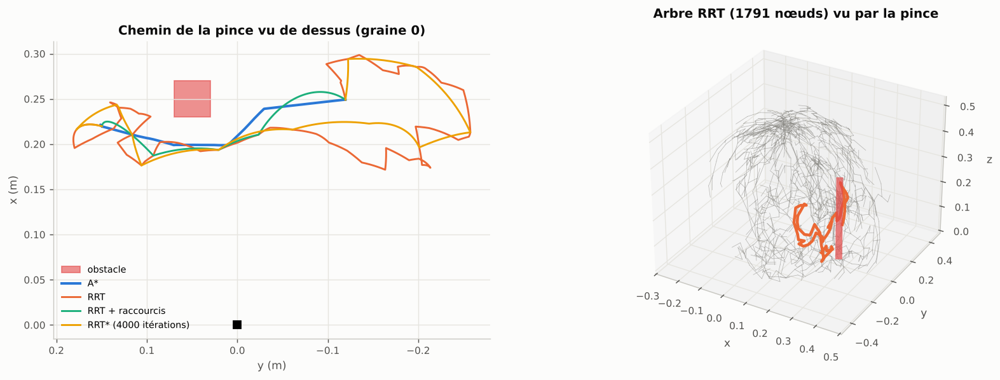
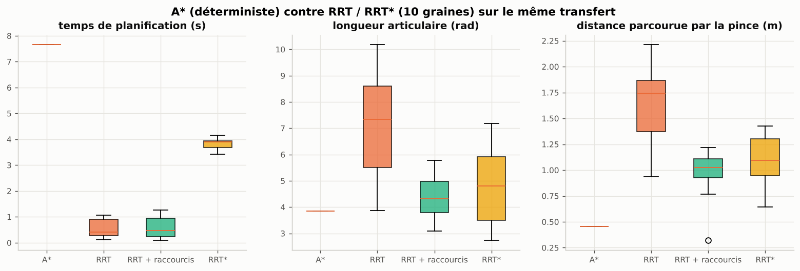

# Aller plus loin — RRT et RRT* contre A* (évitement d'obstacle)

> [← Q8 : A*](07_evitement_obstacles.md) · [Sommaire](../README.md) · [DMP →](09_bonus_DMP.md)
>
> **Statut : simulation** (même scène, même obstacle, même modèle de collision que Q8).

Code : [`partie2_so101/rrt_planner.py`](../partie2_so101/rrt_planner.py), étude
[`simulations/s7_rrt.py`](../simulations/s7_rrt.py).

---

## 1. Algorithmes

A* discrétise l'espace **cartésien de la pince** ; RRT échantillonne directement l'espace des
**configurations** (4 articulations : pan, épaule, coude, poignet), sans IK ni grille.

```
RRT(q_départ, q_but) :
  arbre ← {q_départ}
  répéter N fois :
      q_alea ← q_but avec probabilité 0.1, sinon tirage uniforme dans les butées
      q_proche ← nœud de l'arbre le plus proche de q_alea
      q_nouv ← pas de 0.15 rad de q_proche vers q_alea
      si l'arête q_proche → q_nouv est valide (vérifiée tous les 0.03 rad) : ajouter q_nouv
      si q_nouv = q_but : fin
RRT* : en plus, q_nouv choisit le parent qui minimise le coût depuis la racine parmi les voisins
       (rayon 0.6 rad), puis « recâble » les voisins s'ils deviennent moins chers en passant par
       q_nouv ; on continue après avoir atteint le but pour améliorer le chemin.
Raccourcis : on tire deux nœuds du chemin au hasard et on les relie en ligne droite si c'est valide.
```

Une configuration est valide si le bout de pince est hors des obstacles gonflés et au-dessus de
la table, et si aucune pièce du bras n'est à moins de 6 mm d'un obstacle — **exactement le test
utilisé par A***.

---

## 2. Résultats (transfert « au-dessus de A → au-dessus de B », 10 graines)





| Méthode | succès | temps moyen | nœuds / cases | longueur articulaire (rad) | distance parcourue par la pince |
|---|---|---|---|---|---|
| **A*** (grille 1 cm, lissé) | 1/1 (déterministe) | 7.7 s | 5 560 cases | **3.85** | **45.5 cm** |
| RRT | 10/10 | **0.5 s** | 1 141 nœuds | 7.22 ± 2.03 | 166 ± 40 cm |
| RRT + raccourcis | 10/10 | 0.6 s | 1 141 nœuds | 4.40 ± 0.87 | 96 ± 25 cm |
| RRT* (4 000 itérations) | 10/10 | 3.8 s | 2 631 nœuds | 4.73 ± 1.47 | 109 ± 25 cm |

---

## 3. Analyse

* **RRT est 15 fois plus rapide qu'A*** ici (0.5 s contre 7.7 s) : il ne résout aucune IK et ne
  teste que les configurations qu'il tire. A* paie l'IK et la collision de chaque case évaluée.
* **Mais le chemin RRT est mauvais pour un bras** : 166 cm de trajet de pince pour 45 cm avec A*,
  et surtout un chemin **différent à chaque exécution** (écart-type 40 cm). Dans un pick & place,
  le bras ferait des détours imprévisibles au-dessus de la table.
* Les **raccourcis** (0.1 s de plus) divisent la longueur par 1.7 : indispensables.
* **RRT\*** n'a pas fait mieux que RRT + raccourcis avec 4 000 itérations : son optimalité est
  *asymptotique* ; dans un espace à 4 dimensions avec un rayon de 0.6 rad, le recâblage converge
  lentement, et chaque itération coûte plusieurs tests d'arête (×7 en temps).
* **Le critère compte** : RRT minimise une distance **articulaire**, A* une distance **cartésienne**
  de la pince. Pour un pick & place où l'on veut un geste lisible et prévisible, la distance de la
  pince (A*) est le bon critère ; pour un bras à 6–7 axes ou un passage étroit, la grille 3D ne
  suffit plus (il faudrait aussi planifier l'orientation) et les méthodes par échantillonnage
  reprennent l'avantage.

| Critère | A* (grille cartésienne) | RRT / RRT* (espace articulaire) |
|---|---|---|
| Complétude | complet à la résolution près | probabiliste |
| Optimalité | optimal sur la grille | non (RRT) / asymptotique (RRT*) |
| Coût dominant | IK + collision par case | collision par arête |
| Répétabilité | déterministe | aléatoire (graine) |
| Passe à l'échelle en DDL | mal (la grille grandit vite) | bien |
