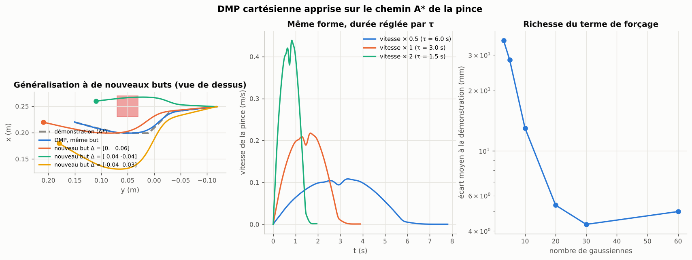
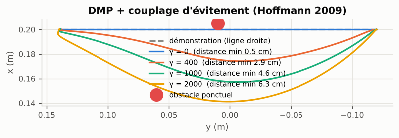
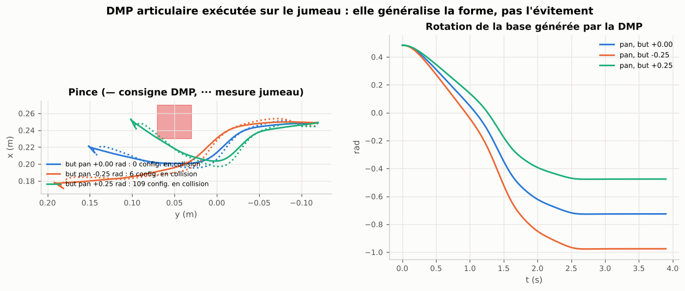

# Aller plus loin — DMP : apprendre un geste et le généraliser

> [← RRT](08_bonus_RRT.md) · [Sommaire](../README.md) · [Améliorations →](10_ameliorations.md)
>
> **Statut : simulation + jumeau.** `dmp.py` a un mode `teach` (bras couple coupé) et un mode
> `real` pour l'essayer sur le SO-101.

Code : [`partie2_so101/dmp.py`](../partie2_so101/dmp.py), étude
[`simulations/s8_dmp.py`](../simulations/s8_dmp.py).

---

## 1. Principe (Ijspeert et al., 2013)

Une DMP est un **ressort-amortisseur critique** vers le but $g$, déformé par un **terme de
forçage** appris sur une démonstration :

$$
\tau\dot z = \alpha_z\big(\beta_z(g - y) - z\big) + f(x), \qquad \tau\dot y = z, \qquad \tau\dot x = -\alpha_x x
$$

$$
f(x) = \frac{\sum_i \psi_i(x)\,w_i}{\sum_i \psi_i(x)}\; x\,(g - y_0), \qquad \psi_i(x) = e^{-h_i (x - c_i)^2}
$$

* $x$ est une « horloge » qui décroît de 1 à 0 : $f$ s'éteint, **la convergence vers $g$ est
  garantie** quelle que soit la démonstration ($\alpha_z = 25$, $\beta_z = \alpha_z/4$ : amortissement critique) ;
* les poids $w_i$ s'obtiennent par **régression pondérée locale** (une formule fermée par gaussienne) ;
* changer $g$ ⇒ même forme vers un autre but ; changer $\tau$ ⇒ même geste plus lent/rapide ;
* en option, un **couplage d'évitement** (Hoffmann et al., 2009) fait tourner la vitesse autour
  d'un obstacle : $\varphi = \gamma\,R\,v\,\theta\,e^{-\beta\theta}$, avec $\theta$ l'angle entre la
  vitesse et la direction de l'obstacle.

```
apprendre(démo Y, dt) : τ ← durée ; y0, g ← Y[0], Y[−1] ; Y', Y'' par différences finies
    f_cible ← τ²Y'' − α_z(β_z(g − Y) − τY')
    pour chaque gaussienne i : w_i ← Σ s ψ_i f_cible / Σ s² ψ_i     (s = x (g − y0))
rejouer(y0, g, τ) : intégrer les 3 équations (Euler, dt) avec le nouveau but / la nouvelle durée
```

---

## 2. Démonstration : le chemin A* de la pince

La démonstration est le chemin de la pince calculé par A* au chapitre Q8 (il contourne le
poteau), ré-échantillonné en 3 s.



| Essai | Résultat |
|---|---|
| Reproduction, 30 gaussiennes | écart moyen **4.3 mm**, max 12.1 mm |
| 3 / 5 / 10 / 20 / 60 gaussiennes | 35.5 / 28.4 / 13.0 / 5.4 / 5.0 mm |
| Nouveaux buts (±4–6 cm) | même forme de contournement, arrivée sur chaque nouveau but (convergence garantie par le ressort) |
| Vitesse ×0.5, ×1, ×2 | profil de vitesse identique, simplement dilaté dans le temps |

* Au-delà de ~20 gaussiennes la précision n'augmente plus (≈ 5 mm) : l'erreur restante vient
  vraisemblablement de l'intégration d'Euler et de la dérivation numérique de la démonstration
  (la démonstration A* a des « coins » que des gaussiennes lisses ne reproduisent pas).
* **Ce que la DMP généralise : la forme.** Le geste « contourner par la gauche » est conservé
  même quand le but bouge de 6 cm.

---

## 3. Évitement d'un obstacle ajouté après coup



| γ | distance minimale à l'obstacle | erreur finale au but |
|---|---|---|
| 0 (DMP seule) | 0.5 cm (collision) | 1.7 mm |
| 400 | 2.9 cm | 1.5 mm |
| 1000 | 4.6 cm | 1.2 mm |
| 2000 | 6.3 cm | 0.4 mm |

Remarque concrète : si l'obstacle est **exactement** sur la ligne démontrée, $\theta = 0$ et le
terme de couplage est nul (singularité connue de cette formulation) ; nous l'avons placé à 5 mm
de la ligne.

---

## 4. DMP articulaire exécutée sur le jumeau : attention à la sécurité

On apprend cette fois les 4 angles du chemin A* et on change le **but de la rotation de base**.



| But (pan) | configurations en collision avec le poteau | écart pince consigne / mesure (jumeau) |
|---|---|---|
| inchangé | 0 / 196 | 15.9 mm |
| −0.25 rad | 6 / 196 | 16.0 mm |
| +0.25 rad | **109 / 196** | 15.9 mm |

**La DMP généralise la forme, pas l'évitement** : en déplaçant le but de +0.25 rad, la forme
apprise fait passer le bras *dans* le poteau pendant plus de la moitié du geste. Une DMP doit donc
être **vérifiée** (même test de collision que A*) ou couplée à un terme d'évitement avant d'être
exécutée. L'écart de 16 mm consigne/mesure vient du jumeau (gravité, dynamique des servos), la
DMP étant envoyée directement à 50 Hz sans LQR.

## 5. Sur le vrai bras

```python
MODE = "teach"   # bras libre : montrer un geste pendant 5 s -> examples/demo_dmp.json
MODE = "real"    # rejoue le geste vers but + DECALAGE_BUT, à VITESSE près
```
Le script refuse de démarrer si le bras est à plus de 0.15 rad du début de la démonstration.
