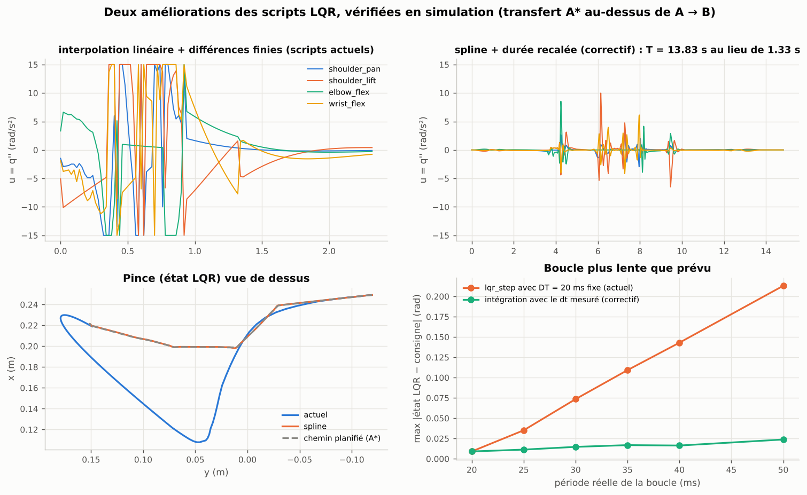

# Aller plus loin — défauts trouvés dans nos scripts et correctifs vérifiés

> [← DMP](09_bonus_DMP.md) · [Sommaire](../README.md) · [Bilan →](11_bilan.md)

Ce chapitre regroupe les **problèmes concrets** que l'analyse et les simulations ont fait
apparaître, avec pour chacun la preuve, la cause et un correctif testé.

| # | Problème | Où | Preuve | Correctif | Gain mesuré |
|---|---|---|---|---|---|
| 1 | `lerobot_IK` déclare « atteinte » toute cible à moins de ~45 mm | bibliothèque, `tol = 1e-3` sur une erreur **quadratique** | `pid_ik_sim.py` : erreur 28.28 mm avec `success = True` ; `pick_place_trajectoire_LQR.py` : `ValueError` 32.4 mm | [`ik_precise.py`](../partie2_so101/ik_precise.py) (tol 1e-10) | 28.28 → **0.46 mm** ; réussite 48 % → 73 % (1 appel) |
| 2 | Pics de u à ±15 rad/s² et état LQR qui **quitte le chemin planifié** | `Reference` : interpolation linéaire + différences finies, durée sans tenir compte des virages | graphe réel (panneau du bas) ; simulation : écart à la trajectoire A* **jusqu'à 106 mm** | spline cubique + dérivées analytiques + durée recalée sur ACC_MAX / VEL_MAX de **chaque** articulation | écart 42.5 → **0.8 mm** en moyenne, u ≤ 10 ; mais durée ×10 (voir ci-dessous) |
| 3 | Boucle réelle plus lente que DT : l'état LQR traîne | `lqr_step` intègre avec `DT` fixe, la consigne avance sur l'horloge murale | graphe réel (état en retard) ; jumeau : durée réelle ⇔ boucle de ~32 ms | intégrer avec le **dt mesuré** | retard à 40 ms : 0.143 → **0.016 rad** |
| 4 | Affaissement sous la gravité (−7.5 mm sur l'étoile, +0.03 rad à l'épaule) | servos à action proportionnelle ; le LQR ne lit pas la mesure | jumeau, chapitres Q6/Q7 | boucle externe intégrale lente sur `mesure − état`, ou compensation de gravité | à tester sur le banc |
| 5 | Scripts PID écrits pour le SO-100 | `pid_ik_real.py` : `get_robot('so100')`, `init_qpos` SO-100 | lecture du code | passer à `so101` et à une pose de départ mesurée | – |

---

## 1. Pics de commande et fidélité au chemin (problème 2)

Code : [`simulations/s9_ameliorations.py`](../simulations/s9_ameliorations.py).

**Cause.** Le chemin articulaire est une suite de points ; `Reference.q(t)` les relie par des
segments de droite, et `Reference.__call__` dérive deux fois par différences finies avec
h = 10 ms. Une courbe anguleuse a une dérivée seconde « en peigne » : chaque coin produit une
impulsion d'accélération, que `lqr_step` sature à 1.5·ACC_MAX. De plus, la durée T est calculée
à partir de la *longueur* du chemin : elle ignore le terme de courbure
$\ddot q = q''(s)\,\dot s^2 + q'(s)\,\ddot s$. Sur un chemin qui tourne, l'accélération réelle
demandée dépasse largement ACC_MAX.

**Correctif.** `ReferenceLisse` : spline cubique $C^2$ du chemin, dérivées **analytiques**, puis
on évalue $\max|\ddot q_j|$ et $\max|\dot q_j|$ sur la trajectoire et on allonge T du facteur
nécessaire (multiplier T par k divise les vitesses par k et les accélérations par k²).



| Variante (transfert A* au-dessus de A → B) | durée | max\|u\| | ∫u² dt | max\|état − consigne\| | écart pince / chemin planifié (moy / max) | max\|mesure − état\| (jumeau) |
|---|---|---|---|---|---|---|
| scripts actuels | 2.3 s | 15 (saturé) | 412 | 0.81 rad | **42.5 / 106 mm** | 0.22 rad |
| spline + durée recalée | 14.8 s | 10 | 29 | 0.009 rad | **0.8 / 3.2 mm** | 0.13 rad |

**Lecture honnête.** Le correctif fait ce qu'il promet (le bras suit le chemin planifié au
millimètre, sans saturation, avec 14 fois moins d'énergie de commande), mais il révèle que le
chemin articulaire planifié contient des virages serrés (changements de branche d'IK,
raccord d'orientation final) qui imposent de ralentir fortement : 14.8 s au lieu de 2.3 s.
Les vraies solutions, à implémenter ensuite :
1. **paramétrage temporel optimal** (TOPP) : ralentir seulement dans les virages ;
2. **lisser le chemin géométrique** avant la loi horaire (raccords circulaires aux sommets) ;
3. planifier directement des trajectoires lisses (optimisation de trajectoire, ex. collocation
   directe — disponible dans pyro : `DirectCollocationTrajectoryOptimisation`).

Dans tous les cas, **la version actuelle ne garantit pas que le bras reste dans le couloir
sans collision calculé par A*** : la marge de 2.5 cm est plus petite que l'écart de suivi.
Aucune collision n'a eu lieu dans ce cas précis, mais c'est de la chance.

## 2. Boucle plus lente que DT (problème 3)

Même figure, panneau en bas à droite :

| Période réelle | retard max, DT fixe (actuel) | retard max, dt mesuré (correctif) |
|---|---|---|
| 20 ms | 0.009 rad | 0.009 rad |
| 30 ms | 0.074 rad | 0.015 rad |
| 40 ms | 0.143 rad | 0.016 rad |
| 50 ms | 0.213 rad | 0.024 rad |

Le correctif tient en trois lignes dans la boucle :

```python
maintenant = time.time()
dt = maintenant - t_precedent ; t_precedent = maintenant
x, u = lqr_step(x, x_ref, K, a_r, dt)        # au lieu du DT global
```

Le retard résiduel (0.016 rad) est celui d'une commande discrète plus lente : le LQR pourrait
aussi être recalculé en **discret** pour la période réelle (`scipy.signal.cont2discrete` +
Riccati discret).
